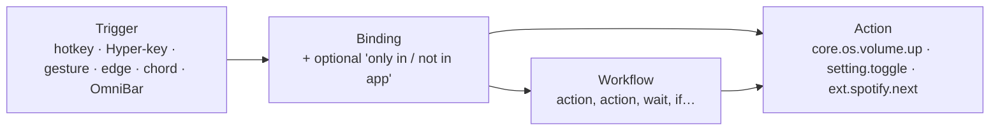
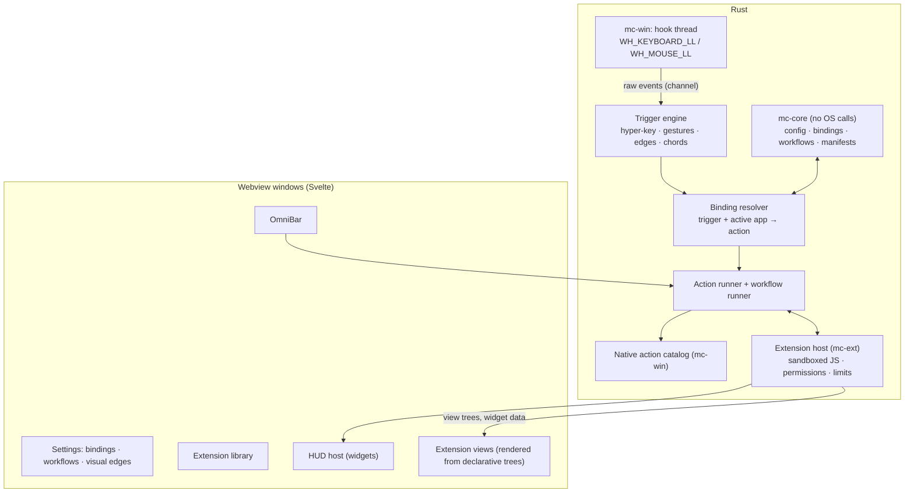

# MouseComb — App Spec (Single Source of Truth)

> **Rules for humans and AI agents**
> 1. Read this file and the latest entry in `DEVLOG.md` before changing anything.
> 2. Cite IDs (`FEAT-xxx`, `DEC-xxx`) when discussing or changing code.
> 3. If a change affects behavior, UI, config or status, update this file in the same change.
> 4. Log each work session in `DEVLOG.md`, not here.

---

## 1. Identity & stack

```yaml
name: MouseComb
tagline: "Bind any key, gesture or screen edge to any Windows command, setting or workflow — and add more with free extensions."
stage: pre-production          # see §10 for versioning rules
build: B-0002                  # manual build counter until production
targets:
  desktop: Windows 10/11 (x64) — first and only desktop target for v1
  mobile:  Android / iOS companion — planned, see §9
stack:
  shell:      Tauri v2
  core:       Rust (stable)
  win32:      `windows` crate (low-level hooks, SendInput, windows, audio, monitors, radios)
  frontend:   TypeScript + Vite + Svelte 5            # DEC-001
  extensions: TypeScript, run in an embedded sandboxed JS engine (QuickJS via `rquickjs`)  # DEC-005
  weather:    Open-Meteo REST (no API key) — in the bundled Weather extension
config: JSON in %APPDATA%\MouseComb\ (config.json, bindings.json, workflows/, extensions/), schema-versioned
```

### Design tokens

| Token | Value | Use |
|---|---|---|
| `bg.idle` | `#000000` | HUD background, AMOLED black |
| `bg.surface` | `#0E0E10` | Modals, settings panels |
| `bg.input` | `#18181B` | Inputs, list rows |
| `accent.run` | `#FF7A00` | Running timer, active zones, primary buttons |
| `accent.text` | `#1A1200` | Text on accent |
| `text.primary` | `#FFFFFF` | |
| `text.secondary` | `#888890` | |
| `radius.modal` / `radius.hud` | `14px` / `8px` | |
| `font` | Segoe UI Variable | Falls back to system UI font |

---

## 2. The model: triggers → bindings → actions

Everything MouseComb does is an **action** with an ID. Anything that starts an action is a **trigger**. A **binding** connects the two, optionally only in certain apps. A **workflow** is a saved list of actions that is itself an action.



- The core ships the triggers, a catalog of native Windows actions, setting actions, and the workflow runner.
- Extensions only add **actions, OmniBar commands, settings, views and HUD widgets**. They never get raw keyboard or mouse hooks. Users bind extension actions with the same binding UI as everything else.
- Anything can be bound to anything. Defaults are just a preset bindings file.

---

## 3. Architecture



**Hard rules for the input layer** (these make it "bulletproof"):
- Hook callbacks only copy the event into a channel and return. All logic runs on the engine thread. Windows silently removes a low-level hook if its callback is slow.
- **Extensions are never on the input path.** The trigger engine decides synchronously whether to swallow a key using only bindings. Running the matched action, including extension code, happens afterwards, asynchronously.
- The engine never leaves a key or button logically "held". Every suppressed down-event is either replayed or matched by a synthetic up-event, including on timeout, focus change and shutdown.
- Events we inject ourselves are tagged (`dwExtraInfo`) and ignored by our own hooks, so they never loop.
- **Global pause:** `CapsLock + Pause` (and a tray toggle) disables every trigger at once.
- **Per-app exclusions:** a process list where gestures, edges and chords are off. Fullscreen-exclusive apps (games) are auto-excluded by default.

### Planned layout

```
MouseComb/
├─ APP_SPEC.md · DEVLOG.md · CLAUDE.md · README.md
├─ app/                 # Svelte frontend (one route per window)
├─ src-tauri/           # Tauri shell: windows, tray, commands, autostart
├─ crates/
│  ├─ mc-core/          # pure Rust: config, bindings, workflows, manifests — reused by mobile
│  ├─ mc-win/           # Windows hooks, SendInput, native action catalog
│  └─ mc-ext/           # extension host: JS sandbox, permission checks, host API
├─ sdk/                 # @mousecomb/api types + `mc` CLI (new, build, dev, publish)
└─ extensions/          # bundled extensions (clock, pomodoro, weather, clipboard, snippets)
```

---

## 4. Core shell — feature registry

Status legend: `PLANNED` · `IN_PROGRESS` · `TESTING` · `DONE` · `DROPPED`. The core is only what extensions can't safely do themselves.

| ID | Feature | Milestone | Status |
|---|---|---|---|
| FEAT-000 | App shell: tray, autostart, single instance, config load/save + live reload | M0 | PLANNED |
| FEAT-008 | CapsLock Hyper-Key | M1 | PLANNED |
| FEAT-013 | Action registry + native Windows action catalog + setting actions | M1 | PLANNED |
| FEAT-014 | Trigger & binding system (any trigger → any action, per-app conditions) | M1 | PLANNED |
| FEAT-004 | OmniBar: command palette for every action, app and extension command | M2 | PLANNED |
| FEAT-009 | Help modals, generated from the live bindings | M2 | PLANNED |
| FEAT-010 | Settings window: bindings editor, recorder, conflict check, visual previews | M2 → M5 | PLANNED |
| FEAT-015 | Workflows (chained actions with waits, conditions, variables) | M3 | PLANNED |
| FEAT-016 | Extension host + SDK + permissions | M4 | PLANNED |
| FEAT-018 | Script commands (local scripts as actions) | M4 | PLANNED |
| FEAT-001 | HUD host (corner overlay that shows extension widgets, proximity fade) | M4 | PLANNED |
| FEAT-006 | Mouse gesture trigger (safe triggers only) | M5 | PLANNED |
| FEAT-007 | Hot edge & corner trigger | M5 | PLANNED |
| FEAT-011 | LMB-hold + scroll chord trigger (opt-in) | M5 | PLANNED |
| FEAT-017 | Extension library (free, in-app store) | M6 | PLANNED |
| FEAT-012 | Mobile companion | M8 | PLANNED |
| — | Window-management preset hotkeys (`Caps+P/M/G`) | — | DROPPED (window actions exist in the catalog, unbound) |
| — | Middle-button drag gestures | — | DROPPED (conflicts with autoscroll and panning) |

### Bundled extensions (ship with the app, removable, built on the public API)
These used to be core features. Building them as extensions proves the extension API is good enough.

| ID | Extension | Contributes | Permissions |
|---|---|---|---|
| FEAT-001b | `mc.clock` | HUD widget: time + date | — |
| FEAT-002 | `mc.pomodoro` | HUD widget, start/pause/reset actions, toast | notifications |
| FEAT-003 | `mc.weather` | HUD widget, refresh action | network: api.open-meteo.com |
| FEAT-005a | `mc.clipboard` | `Caps+V` view, history, paste action | clipboard:read, keys:send |
| FEAT-005b | `mc.snippets` | snippet list, insert action, `{DATE}` `{TIME}` `{USER}` `{CLIPBOARD}` tokens | clipboard:write, keys:send |

---

## 5. Core details

### FEAT-013 — Actions
An action has an `id`, a title, typed parameters, and an optional "needs confirmation" flag. Every action shows up in the OmniBar, the binding editor and the workflow editor.

**Native Windows catalog (`core.os.*`), v1:**

| Group | Actions | Notes |
|---|---|---|
| Input | send keys, type text, mouse click / move / scroll | tagged, never re-triggers MouseComb |
| Apps | launch, focus-or-launch, close, kill | kill asks for confirmation |
| Windows | focus, minimize, maximize, restore, close, snap left/right, move to monitor, always-on-top, opacity | catalog only; no default bindings |
| Desktops | next / prev / go to N, Task View | uses Windows' own shortcuts |
| Audio & media | volume ± / set / mute, mic mute, play/pause/next/prev | output-device switching needs an undocumented API, later |
| Display & system | brightness (laptops), dark/light mode, Wi-Fi / Bluetooth on/off, Night light *(deep link only)* | public APIs where they exist, otherwise opens the right Settings page |
| Windows Settings | open any page (`ms-settings:bluetooth`, `ms-settings:display`, …) | full list of pages in the picker |
| Power | lock, sleep, sign out, restart, shut down | everything but lock asks for confirmation |
| Shell | open file / folder / URL, run command, run PowerShell | run commands are permission-gated, see §6 |
| Clipboard | get / set text | |
| Notify | toast, HUD flash | |

**Setting actions (`setting.*`):** every MouseComb setting, including extension settings, automatically gets `setting.toggle`, `setting.set`, `setting.cycle`. For example, a hotkey can switch RMB gestures on and off or change the HUD monitor. No extra code is needed per setting.

**MouseComb actions (`mc.*`):** open OmniBar, settings, help, pause/resume, reload, show bindings for the current app.

### FEAT-014 — Triggers & bindings
- **Trigger types, v1:** hotkey (any combo, including Win-key combos where Windows allows), Hyper-key combo, key sequence (`Caps`, then `G`, then `C`), gesture, hot edge / corner, mouse chord, OmniBar alias.
- **Later:** schedule (time of day, interval), system events (app opened or focused, monitor connected, wake from sleep, network change).
- **Conditions per binding:** `only in` / `not in` a list of apps (by process name), so `Caps+R` can mean different things in VS Code and Chrome.
- **Binding editor:** press-to-record, a plain-English summary ("Caps + R in Code.exe → Run task 'build'"), live conflict warnings (with another binding, with a known Windows or app shortcut), and import / export of `bindings.json`.
- Reserved, can't be rebound: `Ctrl+Alt+Del`, `Win+L`. Shown as such.

### FEAT-008 — CapsLock Hyper-Key
- `CapsLock` is suppressed. While it is held, the next key goes to the bindings, not to the app.
- Tap alone: nothing. Hold alone ≥ `hyper.capslock_toggle_ms` (default 1500): toggle real CapsLock, with a toast.

### FEAT-004 — OmniBar (`Caps+Space`)
- The command palette for everything: actions, workflows, extension commands, installed apps (Start Menu), URLs, calculator, web search.
- Fuzzy search, recents first. Each result shows its current hotkey, so the OmniBar also teaches shortcuts.
- Extension commands can open a view (list / detail / form) inside the OmniBar.
- `Esc` closes. Focus returns to the previous window.

### FEAT-009 — Help modals
- `Caps+/`: Zen card with the top ~8 bindings for the **current app**. `Caps+Shift+/`: full searchable list of every binding, grouped by trigger type.

### FEAT-015 — Workflows
A workflow is a list of steps saved as JSON in `workflows/`, editable in a visual step editor in Settings.

```jsonc
{
  "id": "wf.focus-mode",
  "title": "Focus mode",
  "steps": [
    { "action": "core.os.audio.mute" },
    { "action": "setting.set", "with": { "key": "edges.enabled", "value": false } },
    { "action": "ext.mc.pomodoro.start" },
    { "action": "core.os.apps.focus_or_launch", "with": { "exe": "Code.exe" } },
    { "if": { "app_running": "Spotify.exe" }, "then": [ { "action": "core.os.media.pause" } ] },
    { "wait_ms": 300 },
    { "action": "core.os.notify.toast", "with": { "text": "Focus on. {pomodoro.remaining} left." } }
  ]
}
```

- Steps: action, `wait_ms`, `if` (app running, app focused, setting value, time between), `ask` (pick from a list in the OmniBar, store as variable).
- Variables: `{clipboard}`, `{selection}` (copied safely and restored), `{date}`, `{time}`, step outputs.
- Runs off the input thread. A step error stops the workflow with a toast naming the step. `mc.workflow.stop_all` is always available.

### FEAT-016 — Extensions
**What an extension is:** a folder with `manifest.json` and a bundled `main.js` (written in TypeScript with the SDK).

```jsonc
{
  "id": "com.example.spotify",
  "name": "Spotify Controls",
  "version": "1.2.0",
  "api": 1,
  "permissions": ["network:api.spotify.com", "notifications"],
  "contributes": {
    "actions":  [ { "id": "like-current", "title": "Like current song" } ],
    "commands": [ { "id": "search", "title": "Search Spotify", "view": "list" } ],
    "settings": [ { "key": "market", "type": "string", "default": "US" } ],
    "widgets":  [ { "id": "now-playing", "slot": "hud" } ],
    "suggested_bindings": [ { "trigger": "hyper+L", "action": "like-current" } ]
  }
}
```

- **Runtime:** each extension runs in its own QuickJS context inside `mc-ext`, with memory and CPU-time limits. A runaway extension is stopped and reported, and MouseComb keeps working.
- **Host API (`@mousecomb/api`):** `actions.run(id, params)` (any core or extension action, subject to permissions), `settings`, `storage` (per-extension), `http.fetch` (allowed domains only), `clipboard`, `notify`, `hud.update(widget, data)`, `ui.show(view)`.
- **UI:** extensions return declarative views (List, Detail, Form, Grid, Widget). MouseComb renders them with its own components, so every extension looks native and can't draw over your screen.
- **Suggested bindings** are offered at install. Nothing is bound without the user saying yes.
- **SDK CLI:** `mc new`, `mc dev` (hot reload into the running app), `mc build`, `mc publish` (opens a PR to the library).

**Permissions** (shown at install like browser extensions; a new version that asks for more needs re-approval):

| Permission | Allows |
|---|---|
| `network:<domain>` | HTTP to that domain only |
| `clipboard:read` / `clipboard:write` | read / write clipboard |
| `keys:send` | type text and send key combos via core actions |
| `windows` | window actions on other apps |
| `apps:launch` | start apps, open files and URLs |
| `shell` | run commands / PowerShell (**high risk**, red badge, library review required) |
| `files:<path>` | read/write inside a chosen folder |
| `notifications` | toasts |

### FEAT-018 — Script commands
- Drop a `.ps1`, `.py`, `.bat`, `.cmd` or `.ahk` file with a header comment into `scripts/` and it becomes an action that can be bound or used in workflows.
- Runs as a normal process with your rights, so it is **local only**: never in the library, marked "unsandboxed" in the UI.

```powershell
# @mc.title   Restart audio service
# @mc.confirm true
Restart-Service Audiosrv
```

### FEAT-017 — Extension library
- Free and open source: one public GitHub repo (`mousecomb-extensions`, DEC-006) with one folder per extension.
- Publishing = pull request. CI checks the manifest, permissions, bundle size and API version, builds the bundle and records its SHA-256. A human approves every `shell` or `windows` permission.
- The in-app **Library** browses the index (search, categories, screenshots, permission badges), installs in one click, verifies the hash, and updates automatically.
- **Developer mode:** load an unpacked extension from a local folder, with a persistent "unverified" badge.

### FEAT-001 — HUD host
- Transparent, borderless, always-on-top, click-through window, bottom-right of the work area. It shows widgets from extensions (clock, pomodoro, weather by default), stacked in the order you choose.
- **Proximity fade:** opacity follows the cursor's distance (position from the mouse hook). Hidden within `hud.fade_near_px`, fully visible beyond `hud.fade_far_px`.
- **Holding Ctrl** makes the HUD visible and clickable. A widget's `Ctrl+click` / `Ctrl+right-click` run actions it declares (e.g. pomodoro start/pause, reset).

### FEAT-006 — Gesture trigger (safe triggers)
**Principle:** only triggers that no common app already uses, so existing habits keep working.

| Trigger | Default | Why |
|---|---|---|
| `CapsLock` held + LMB drag | **ON** | CapsLock is already ours. Caps+drag has no native meaning anywhere. |
| RMB drag | **OFF (opt-in)** | Fights apps that use RMB-drag (Explorer copy/move menu, CAD/3D, games, browser gesture extensions). When on: RMB-down is held back. If movement stays under `gestures.threshold_px` before release, the click is replayed unchanged, so context menus still work. |
| `Ctrl+Shift` + drag | **not offered** | Explorer creates shortcuts, editors extend selections, design tools constrain. |

- 4 directions with a dominant-axis ratio (diagonals are ignored rather than guessed), Esc or returning to the start cancels, optional trail.
- Each direction is a trigger like any other. Default bindings: Left = Back, Right = Forward, Up = next app, Down = previous app.
- Defaults: `threshold_px` 18, `axis_ratio` 2.0, `max_duration_ms` 1500.

### FEAT-007 — Hot edge & corner trigger
- 4 edges + 4 corners per monitor. Only outer edges count, never the borders between two monitors.
- Each zone has a **scroll-up**, **scroll-down** and **dwell** trigger, bindable to any action or workflow.
- Defaults: left edge scroll = desktop prev/next, right edge scroll = volume. All corners off. Edge 2 px, corner 8×8 px, dwell 350 ms, 600 ms cooldown, max cursor speed for dwell.

### FEAT-011 — LMB + scroll chord
- Hold LMB + wheel down / up are two triggers. Defaults `Enter` / `Esc`. **Off by default** (holding LMB while scrolling is a real habit when selecting). Per-app opt-in recommended.

### FEAT-010 — Settings window
See every change while you make it.
- **Bindings:** one table of every trigger → action, filter by app, trigger type or extension. Recorder, conflict warnings, plain-English summaries.
- **Workflows:** step editor with drag to reorder, a "Run now" button and a per-step result log.
- **Edges (visual):** live map of the real monitor layout with clickable zones, sliders that redraw the map, "Show on screen" overlay with a live readout of what the cursor would trigger.
- **Gestures:** animated arrow per direction, threshold radius drawn as a circle. **HUD:** fade rings around a mock HUD, widget order.
- **Extensions:** installed list, permissions, settings (auto-generated from manifests), enable/disable, logs.
- Saves instantly (debounced). Undo and Reset per section. A corrupt file falls back to defaults with a warning.

---

## 6. Safety model

| Risk | Guard |
|---|---|
| Slow or broken extension freezes input | Extensions never run on the input path. Per-extension CPU/memory limits. Crashes are isolated. |
| Extension does something you didn't expect | Permissions declared in the manifest and approved at install. The host API checks each call. Every action run is in a log you can open. |
| Destructive commands (shutdown, kill, shell) | `needs confirmation` flag, an OmniBar confirm step, and a red badge in bindings. |
| Malicious library extension | Open source, CI checks, human review for high-risk permissions, hash-verified installs, one-click disable. |
| Stuck keys / runaway workflow | Input rules in §3, `Caps+Pause` global pause, `mc.workflow.stop_all`. |
| Elevated windows | DEC-002. Without elevation, actions can't touch admin windows. Shown clearly rather than failing silently. |

---

## 7. Config files (v1, abridged)

```jsonc
// config.json — core settings (every key is also a setting.* action)
{
  "schema": 1, "paused": false,
  "exclusions": { "processes": [], "auto_fullscreen": true },
  "hyper":     { "capslock_toggle_ms": 1500 },
  "hud":       { "monitor": "primary", "fade_near_px": 60, "fade_far_px": 220, "widgets": ["mc.clock", "mc.pomodoro", "mc.weather"] },
  "gestures":  { "caps_drag": true, "rmb_drag": false, "threshold_px": 18, "axis_ratio": 2.0, "max_duration_ms": 1500, "show_trail": true },
  "chords":    { "lmb_scroll": false },
  "edges":     { "enabled": true, "edge_px": 2, "corner_px": 8, "dwell_ms": 350, "cooldown_ms": 600 },
  "omnibar":   { "search_url": "https://duckduckgo.com/?q={q}" },
  "extensions":{ "dev_mode": false, "auto_update": true }
}

// bindings.json — trigger → action
[
  { "trigger": "hyper+Space",            "action": "mc.omnibar.open" },
  { "trigger": "hyper+/",                "action": "mc.help.zen" },
  { "trigger": "hyper+Pause",            "action": "mc.pause.toggle" },
  { "trigger": "gesture:caps:left",      "action": "core.os.input.send", "with": { "keys": "Alt+Left" } },
  { "trigger": "edge:left:scroll_up",    "action": "core.os.desktops.prev" },
  { "trigger": "edge:right:scroll_up",   "action": "core.os.audio.volume_up" },
  { "trigger": "hyper+R", "when": { "only_in": ["Code.exe"] }, "action": "wf.build-and-run" }
]
```

---

## 8. Milestones

| M | Scope | Exit check |
|---|---|---|
| M0 | Tauri workspace, tray, single instance, config load/save/reload, empty Settings shell | `cargo tauri dev` runs; config round-trips |
| M1 | Hook thread, Hyper-Key, action registry, first native actions, bindings engine with app conditions, global pause | No stuck keys in a 30-min stress session; 30+ native actions bindable |
| M2 | OmniBar, help modals, Settings: bindings editor + recorder | Any action findable in OmniBar and bindable without editing JSON |
| M3 | Workflows: runner + step editor | "Focus mode" example runs end to end |
| M4 | Extension host, SDK + CLI, permissions, script commands, HUD host; bundled clock, pomodoro, weather, clipboard, snippets | All five bundled extensions built only on the public API |
| M5 | Gesture, edge and chord triggers + visual Settings | RMB menus still work with RMB-drag on; every edge setting previewable |
| M6 | Extension library repo, CI, in-app Library | Install, update, disable a library extension; permission re-approval works |
| M7 | Hardening → **production 1.0**: installer, autostart, elevation, signing, crash log | See §10 |
| M8 | Mobile companion | See §9 |

---

## 9. Mobile plan (FEAT-012)

Android and iOS don't let apps hook global input or draw over other apps. Triggers, native actions and the input engine are **desktop-only**. The mobile build is a **companion** that reuses `mc-core`:
- Browse and edit bindings and workflows for the desktop (export/import file first, sync later).
- Run desktop workflows remotely from the phone (later, once pairing/sync is designed).
- Extensions that only use `network`, `storage`, `notifications` and views could run on mobile too (API v2 decision).
- Rule: no OS calls in `mc-core`, so it builds for every target.

---

## 10. Versioning policy

- **Pre-production (now):** no SemVer, tags or releases. Each work session bumps the manual build counter (`B-0001`, `B-0002`, …) in §1 and `DEVLOG.md`. Use git worktrees for parallel experiments (`git worktree add ../mc-<topic> -b wip/<topic>`). Merge or delete them, don't let them drift.
- **Production (from 1.0.0, end of M7):** SemVer for the app **and** for the extension API (`api: 1`). `CHANGELOG.md`, annotated tags, GitHub Releases with signed installers, conventional commits, protected `main`. `DEVLOG.md` is then frozen as pre-history.

---

## 11. Open decisions

| ID | Question | Current default |
|---|---|---|
| DEC-001 | Frontend framework | Svelte 5 + TS |
| DEC-002 | Elevation (actions can't touch admin windows unless MouseComb is elevated) | Run normally; optional "Start elevated" via a logon scheduled task |
| DEC-003 | Default gesture Up/Down | Next / previous app |
| DEC-004 | Prototype modules `Plugins` / `StickyEngine` | Superseded by the extension system; a sticky-notes extension can come later |
| DEC-005 | Extension runtime | TypeScript on embedded QuickJS (small, fast start, easy to write). Alternative: WebAssembly (any language, harder to write) |
| DEC-006 | Library hosting | Public GitHub repo + generated index; no server to run or pay for |
| DEC-007 | Window actions in the catalog without default bindings, given the dropped `Caps+P/M/G` preset | Keep in catalog, unbound |
