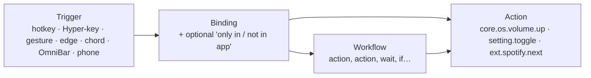
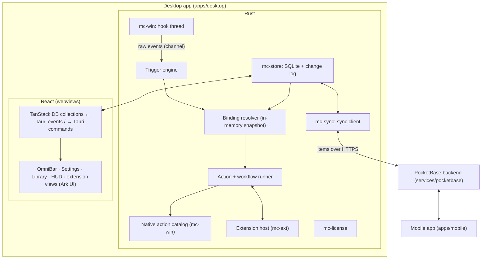

# MouseComb — App Spec (Single Source of Truth)

> **Rules for humans and AI agents**
> 1. Read this file and the latest entry in `DEVLOG.md` before changing anything.
> 2. Cite IDs (`FEAT-xxx`, `DEC-xxx`) when discussing or changing code.
> 3. If a change affects behavior, UI, data, config or status, update this file in the same change.
> 4. Log each work session in `DEVLOG.md`, not here.

---

## 1. Identity & stack

```yaml
name: MouseComb
tagline: "Bind any key, gesture or screen edge to any Windows command, setting or workflow. Add more with free extensions. Your setup follows you to every device."
stage: pre-production          # first installable release at the end of M1 (§11)
build: B-0005                  # manual counter until the first release; then w.x.y.z+b (VERSIONING.md)
product: Free edition + paid Pro edition (see §9)
targets:
  desktop: Windows 10/11 (x64, later ARM64) — first desktop target
  mobile:  Android + iOS companion app (see §12)
  later:   macOS desktop (needs its own input adapter; everything else is shared)
```

| Layer | Choice | Why |
|---|---|---|
| App shell | **Tauri v2** + official plugins (DEC-008) | Small native installer, tray, updater, autostart; same project builds Android/iOS |
| Core language | **Rust** (stable), Cargo workspace | Fast, memory-safe; one core for desktop and mobile |
| Windows access | `windows` crate | Low-level hooks, SendInput, audio, monitors, radios |
| UI framework | **React 19 + TypeScript + Vite** (DEC-001) | Largest ecosystem, shared by desktop, mobile and extension views |
| UI components | **Ark UI** (React components built on **Zag.js** state machines); raw `@zag-js/*` machines for custom widgets | Accessible, keyboard-complete, predictable state; headless so it takes our design |
| Styling | Tailwind CSS v4 with MouseComb tokens as CSS variables | Fast to build, themeable, tiny output |
| Icons | Small built-in set in `packages/ui` (Fluent line style) | Native look without a multi-megabyte icon package |
| Routing | **TanStack Router** | Type-safe routes and search params, one route per window |
| Live data | **TanStack DB** collections backed by the Rust store; **TanStack Query** for one-off calls | Live queries and optimistic edits; the Rust core stays the source of truth |
| Tables & lists | **TanStack Table** + **TanStack Virtual** | Bindings table, action log, OmniBar and clipboard lists with thousands of rows |
| Forms | **TanStack Form** + Zod 4 | Settings and extension-settings forms, generated from schemas |
| Timing | **TanStack Pacer** | Debounced saves, throttled live previews |
| Rust ↔ TS types | `tauri-specta` | Commands and events are typed end to end, no hand-written glue |
| Local data | SQLite (`rusqlite`, bundled) in `mc-store` | Same database file format on every device; dirty flags for sync |
| Backend | **PocketBase v0.40** embedded as a Go framework (`services/pocketbase`) (DEC-010) | Free, open source, one small binary with auth, REST and realtime; you own the data |
| Sync | `mc-sync`: `Backend` trait + PocketBase adapter, per-record last-writer-wins | Same data on every PC and the phone; another backend (e.g. Firebase) plugs in behind the trait |
| Extensions | TypeScript on embedded QuickJS (`rquickjs`), views written in JSX (DEC-005) | Easy to write, sandboxed, fast to start |
| Weather | Open-Meteo REST (no API key) | In the bundled Weather extension |
| Tests | `cargo test` (incl. live backend tests), Vitest, Playwright screenshots of the UI with a mock backend | |

### Design tokens

| Token | Value | Use |
|---|---|---|
| `bg.idle` | `#000000` | HUD background, AMOLED black |
| `bg.surface` | `#0E0E10` | Modals, settings panels |
| `bg.input` | `#18181B` | Inputs, list rows |
| `accent.run` | `#FF7A00` | Running timer, active zones, primary buttons |
| `accent.text` | `#1A1200` | Text on accent |
| `text.primary` | `#FFFFFF` | |
| `text.secondary` | `#888890` | |
| `radius.modal` / `radius.hud` | `14px` / `8px` | |
| `font` | Segoe UI Variable | Falls back to system UI font (mobile: platform font) |

Tokens live once in `packages/ui/tokens.css` and are shared by desktop, mobile and extension views.

---

## 2. The model: triggers → bindings → actions

Everything MouseComb does is an **action** with an ID. Anything that starts an action is a **trigger**. A **binding** connects the two, optionally only in certain apps. A **workflow** is a saved list of actions that is itself an action.



- The core ships the triggers, a catalog of native Windows actions, setting actions, and the workflow runner.
- Extensions only add **actions, OmniBar commands, settings, views and HUD widgets**. They never get raw keyboard or mouse hooks.
- Anything can be bound to anything. Defaults are just a preset bindings set.

---

## 3. Architecture



**Hard rules for the input layer** (these make it "bulletproof"):
- Hook callbacks only copy the event into a channel and return. All logic runs on the engine thread. Windows silently removes a low-level hook if its callback is slow.
- The binding resolver reads an **in-memory snapshot**. No database, network, license or extension call ever happens on the input path.
- **Extensions are never on the input path.** Running the matched action, including extension code, happens afterwards, asynchronously.
- The engine never leaves a key or button logically "held". Every suppressed down-event is either replayed or matched by a synthetic up-event, including on timeout, focus change and shutdown.
- Events we inject ourselves are tagged (`dwExtraInfo`) and ignored by our own hooks, so they never loop.
- **Global pause:** `CapsLock + Pause` (and a tray toggle) disables every trigger at once.
- **Per-app exclusions:** a process list where gestures, edges and chords are off. Fullscreen-exclusive apps (games) are auto-excluded by default.

### Repository layout (monorepo: pnpm workspaces + Cargo workspace)

```
MouseComb/
├─ APP_SPEC.md · DEVLOG.md · CLAUDE.md · README.md
├─ apps/
│  ├─ desktop/          # Tauri v2 Windows app: src-tauri/ (Rust shell) + src/ (React, TanStack Router)
│  └─ mobile/           # Tauri v2 Android/iOS app (React)
├─ packages/
│  ├─ ui/               # design system: tokens, Tailwind preset, Ark UI components styled for MouseComb
│  ├─ data/             # TanStack DB collections + Query hooks over Tauri commands (shared by desktop + mobile)
│  ├─ bindings/         # TypeScript types generated from Rust by tauri-specta
│  └─ api/              # @mousecomb/api extension SDK + `mc` CLI
├─ crates/
│  ├─ mc-core/          # no OS calls: data model, merge rule, ids (later: binding resolver, workflow engine)
│  ├─ mc-store/         # SQLite schema, migrations, dirty tracking
│  ├─ mc-sync/          # Backend trait, PocketBase adapter, sync pass
│  ├─ mc-license/       # (M7) license verification
│  ├─ mc-win/           # (M1) Windows hooks, SendInput, native action catalog
│  └─ mc-ext/           # (M4) extension host: QuickJS sandbox, permissions, host API
├─ extensions/          # (M4) bundled extensions (clock, pomodoro, weather, clipboard, snippets)
└─ services/
   └─ pocketbase/       # the backend: auth, items, devices; deploy notes in its README
```

---

## 4. UI layer

### Windows (each is a TanStack Router route in one React app)

| Window | Route | Traits |
|---|---|---|
| HUD | `/hud` | transparent, click-through (unless Ctrl held), always-on-top, no taskbar entry |
| OmniBar | `/omnibar` | centered, borderless, Mica/Acrylic backdrop, hides on blur |
| Settings | `/settings/*` (bindings, workflows, edges, gestures, hud, extensions, library, account) | normal window, Mica backdrop, sidebar |
| Library | `/settings/library` | browse / install extensions |
| Help | `/help/zen`, `/help/all` | centered, borderless |
| Edge overlay | `/overlay` | per monitor, only while "Show on screen" is on |

Windows are created at startup and hidden, so showing one is instant.

### Which tool does what

| Need | Tool | Example |
|---|---|---|
| Interactive component behavior | Ark UI (Zag machines) | Combobox for the OmniBar, Slider for edge sizes, Dialog, Menu, Tabs, Toast, Tooltip, Tree View for workflows, Tour for onboarding, Splitter, Floating Panel |
| Custom widget behavior | `@zag-js/*` machine directly | Key recorder, gesture preview, monitor map |
| Live app data | TanStack DB | `bindings`, `workflows`, `snippets`, `extensions` collections with live queries |
| One-off calls | TanStack Query | weather fetch, library index, license status |
| Big tables | TanStack Table + Virtual | bindings table (filter by app, trigger, extension), action log |
| Big lists | TanStack Virtual | OmniBar results, clipboard history |
| Forms | TanStack Form + Zod 4 | settings sections, extension settings generated from manifest schemas |
| Debounce/throttle | TanStack Pacer | save 300 ms after the last change; throttle slider previews to 60 fps |

### Native Windows feel
- Mica (Settings) and Acrylic (OmniBar) backdrops through Tauri window effects, Windows 11 rounded corners, Segoe UI Variable, Fluent icons.
- Native tray menu, native toasts, native file dialogs, "start with Windows", follows the system light/dark mode and accent color where it fits the brand.
- Keyboard-complete: every screen works without a mouse (Ark/Zag handle focus and keyboard rules).

### Data flow between Rust and React
- Rust is the source of truth. `packages/data` defines TanStack DB collections whose **sync** subscribes to typed Tauri events (`bindings_changed`, …) and whose **onInsert / onUpdate / onDelete** call typed Tauri commands.
- React screens use live queries, so a change made by a hotkey, a workflow, an extension or another device (via sync) appears on screen immediately.
- The mobile app uses the same `packages/data` against its own local store.

---

## 5. Data & sync (FEAT-020)

### What's stored where
All user data lives in one SQLite database per device (`%APPDATA%\com.mousecomb.app\mousecomb.db` on Windows). Import/export as readable JSON is planned.

| Record type | Synced across devices? |
|---|---|
| Bindings, workflows, snippets | yes |
| Settings | yes, except those marked **this device only** (HUD monitor, edge geometry, script paths, exclusions) |
| Installed extensions list + their settings | yes (extensions install on each desktop by themselves) |
| Clipboard history | **off by default**; opt-in, and only once end-to-end encryption exists (DEC-014) |
| Pomodoro sessions, action log | stats yes / log no |
| License | no (per device, see §9) |

### How sync works (built in B-0004)
- **Backend:** one `items` collection in PocketBase holds every synced record of every user (`user`, `kind`, `key`, `data`, `mtime`, `deleted`, `device`). API rules let each account see and change only its own rows. New kinds (for example an extension's data) need no server change.
- **Record ids** are derived from user + kind + key (`mc_core::remote_id`), so two devices that create the same setting write the same record.
- **Merge rule: last writer wins per record**, by the editing device's `mtime`. Ties are settled by device id, so every device reaches the same answer. The server enforces it too: an update older than the stored copy is rejected with `409`. Deletes are tombstones.
- **A sync pass:** pull everything changed since the last cursor (`updated`, `id`, keyset paging), merge it, then push local items marked dirty. Interrupted passes resume safely.
- **When:** at startup, about 1.5 s after a local change, every 60 s, and on "Sync now". Edits made during a pass trigger another pass.
- **Sign-in:** local data made while signed out (or with another account) is queued to join the account. Sign-out can keep or remove data on the PC.
- **Session:** the sign-in token lives in Windows Credential Manager and refreshes daily; an expired session signs out with a clear message.
- **Rate limits:** the server limits sign-in attempts; the client waits and retries, then shows "Too many attempts".
- **Privacy today:** data is protected by HTTPS (in production) and per-account rules, but whoever runs the server can read it. End-to-end encryption, QR pairing and a recovery phrase come before clipboard sync ships (DEC-014).
- **Free vs Pro:** sync is free during pre-production; Pro gating arrives with licensing in M7 (DEC-009).
- **Realtime:** PocketBase's realtime subscriptions will replace the 60 s poll in a later build.

### Phone → desktop actions
- The phone can ask a desktop to run a workflow or action. It writes a "run request" record, and the desktop receives it through sync.
- Only workflows you mark **Allow from phone** can run this way. Each request shows a toast on the desktop and lands in the action log.

---

## 6. Core shell — feature registry

Status legend: `PLANNED` · `IN_PROGRESS` · `TESTING` · `DONE` · `DROPPED`.

| ID | Feature | Milestone | Status |
|---|---|---|---|
| FEAT-000 | App shell: tray, autostart, single instance, store, windows pre-created | M0 | IN_PROGRESS (all but extra windows) |
| FEAT-008 | CapsLock Hyper-Key | M1 | PLANNED |
| FEAT-013 | Action registry + native Windows action catalog + setting actions | M1 | PLANNED |
| FEAT-014 | Trigger & binding system (any trigger → any action, per-app conditions) | M1 | PLANNED |
| FEAT-004 | OmniBar: command palette (opens Settings, runs quick commands, later every action) | M1 | PLANNED |
| FEAT-009 | Help modals, generated from the live bindings | M2 | PLANNED |
| FEAT-010 | Settings window: bindings editor, recorder, conflict check, visual previews | M2 → M5 | IN_PROGRESS (shell, General with HUD preview, Snippets, Account, About) |
| FEAT-015 | Workflows | M3 | PLANNED |
| FEAT-016 | Extension host + SDK + permissions | M4 | PLANNED |
| FEAT-018 | Script commands | M4 | PLANNED |
| FEAT-001 | HUD with Clock widget, proximity fade | M1 | PLANNED |
| FEAT-006 | Mouse gesture trigger (safe triggers only) | M5 | PLANNED |
| FEAT-007 | Hot edge & corner trigger | M5 | PLANNED |
| FEAT-011 | LMB-hold + scroll chord trigger (opt-in) | M5 | PLANNED |
| FEAT-017 | Extension library (free, in-app store) | M6 | PLANNED |
| FEAT-019 | Editions, licensing, purchase, account | M7 | PLANNED |
| FEAT-020 | Data store, account and sync (E2E encryption later) | M0 | IN_PROGRESS (store, auth, sync done; realtime, E2E, export pending) |
| FEAT-012 | Mobile app | M10 | PLANNED |
| FEAT-021 | Sign-in page on first launch | M1 | PLANNED |
| FEAT-022 | Installer + weekly auto-updates | M1 | PLANNED |
| FEAT-023 | Quick commands: calculator, app launcher, web search, copy a snippet | M1 | PLANNED |
| FEAT-024 | Usage telemetry (opt-in) + weekly usage report | M2 | PLANNED |
| FEAT-025 | Release automation: version from commits, changelog, tags | M2 | PLANNED |
| — | Window management (`Caps+P/M/G` and all window actions) | — | DROPPED (DEC-007) |
| — | Middle-button drag gestures | — | DROPPED (conflicts with autoscroll and panning) |

### Bundled extensions (ship with the app, removable, built on the public API)

| ID | Extension | Contributes | Permissions |
|---|---|---|---|
| FEAT-001b | `mc.clock` | HUD widget: time + date (built in M1 inside the core, moved behind the extension API in M5) | — |
| FEAT-002 | `mc.pomodoro` | HUD widget, start/pause/reset actions, toast, synced sessions (built in M1 inside the core, moved in M5) | notifications |
| FEAT-003 | `mc.weather` | HUD widget, refresh action | network: api.open-meteo.com |
| FEAT-005a | `mc.clipboard` | `Caps+V` view, history, paste action | clipboard:read, keys:send |
| FEAT-005b | `mc.snippets` | snippet list, insert action, `{DATE}` `{TIME}` `{USER}` `{CLIPBOARD}` tokens (data + editor built in B-0004 as core) | clipboard:write, keys:send |

---

## 7. Core details

### FEAT-013 — Actions
An action has an `id`, a title, typed parameters, and an optional "needs confirmation" flag. Every action shows up in the OmniBar, the binding editor and the workflow editor.

**Native Windows catalog (`core.os.*`), v1:**

| Group | Actions | Notes |
|---|---|---|
| Input | send keys, type text, mouse click / move / scroll | tagged, never re-triggers MouseComb |
| Apps | launch, focus-or-launch, close, kill | kill asks for confirmation |
| Desktops | next / prev / go to N, Task View | uses Windows' own shortcuts |
| Audio & media | volume ± / set / mute, mic mute, play/pause/next/prev | output-device switching needs an undocumented API, later |
| Display & system | brightness (laptops), dark/light mode, Wi-Fi / Bluetooth on/off, Night light *(deep link only)* | public APIs where they exist, otherwise opens the right Settings page |
| Windows Settings | open any page (`ms-settings:bluetooth`, `ms-settings:display`, …) | full list of pages in the picker |
| Power | lock, sleep, sign out, restart, shut down | everything but lock asks for confirmation |
| Shell | open file / folder / URL, run command, run PowerShell | permission-gated for extensions |
| Clipboard | get / set text | |
| Notify | toast, HUD flash | |

**Setting actions (`setting.*`):** every MouseComb and extension setting automatically gets `setting.toggle`, `setting.set`, `setting.cycle`.

**MouseComb actions (`mc.*`):** open OmniBar, settings, help, pause/resume, reload, show bindings for the current app, sync now.

### FEAT-014 — Triggers & bindings
- **Trigger types, v1:** hotkey, Hyper-key combo, key sequence (`Caps`, then `G`, then `C`), gesture, hot edge / corner, mouse chord, OmniBar alias, **phone request** (FEAT-020).
- **Pro triggers:** schedule (time of day, interval), system events (app opened or focused, monitor connected, wake from sleep, network change).
- **Conditions per binding:** `only in` / `not in` a list of apps (by process name).
- **Binding editor:** press-to-record, a plain-English summary, live conflict warnings (with another binding, with known Windows or app shortcuts), import / export.
- Reserved, can't be rebound: `Ctrl+Alt+Del`, `Win+L`.

### FEAT-008 — CapsLock Hyper-Key
- `CapsLock` is suppressed. While it is held, the next key goes to the bindings, not to the app.
- Tap alone: nothing. Hold alone ≥ `hyper.capslock_toggle_ms` (default 1500): toggle real CapsLock, with a toast.

### FEAT-004 — OmniBar (`Caps+Space`)
- One place for everything: actions, workflows, extension commands, installed apps (Start Menu), URLs, calculator, web search. Built on Ark Combobox + TanStack Virtual.
- Fuzzy search, recents first. Each result shows its current hotkey.
- Extension commands can open a view (list / detail / form) inside the OmniBar.
- `Esc` closes. Focus returns to the previous window.

### FEAT-009 — Help modals
- `Caps+/`: the top ~8 bindings for the **current app**. `Caps+Shift+/`: every binding, searchable, grouped by trigger type.

### FEAT-015 — Workflows
A workflow is a list of steps stored in the database, edited in a visual step editor (Ark Tree View + drag to reorder).

```jsonc
{
  "id": "wf.focus-mode",
  "title": "Focus mode",
  "allow_from_phone": true,
  "steps": [
    { "action": "core.os.audio.mute" },
    { "action": "setting.set", "with": { "key": "edges.enabled", "value": false } },
    { "action": "ext.mc.pomodoro.start" },
    { "action": "core.os.apps.focus_or_launch", "with": { "exe": "Code.exe" } },
    { "if": { "app_running": "Spotify.exe" }, "then": [ { "action": "core.os.media.pause" } ] },
    { "wait_ms": 300 },
    { "action": "core.os.notify.toast", "with": { "text": "Focus on. {pomodoro.remaining} left." } }
  ]
}
```

- Steps: action, `wait_ms`, `if` (app running, app focused, setting value, time between), `ask` (pick from a list in the OmniBar, store as variable).
- Variables: `{clipboard}`, `{selection}` (copied safely and restored), `{date}`, `{time}`, step outputs.
- Runs off the input thread. A failing step stops the workflow with a toast naming the step. `mc.workflow.stop_all` is always available.

### FEAT-016 — Extensions
**What an extension is:** a folder with `manifest.json` and a bundled `main.js`, written in TypeScript with the SDK.

```jsonc
{
  "id": "com.example.spotify",
  "name": "Spotify Controls",
  "version": "1.2.0",
  "api": 1,
  "permissions": ["network:api.spotify.com", "notifications"],
  "contributes": {
    "actions":  [ { "id": "like-current", "title": "Like current song" } ],
    "commands": [ { "id": "search", "title": "Search Spotify", "view": "list" } ],
    "settings": [ { "key": "market", "type": "string", "default": "US" } ],
    "widgets":  [ { "id": "now-playing", "slot": "hud" } ],
    "suggested_bindings": [ { "trigger": "hyper+L", "action": "like-current" } ]
  }
}
```

- **Runtime:** each extension runs in its own QuickJS context inside `mc-ext`, with memory and CPU-time limits. A runaway extension is stopped and reported.
- **Views in JSX:** authors write `<List>`, `<List.Item>`, `<Detail>`, `<Form>`, `<Widget>` in JSX. The SDK turns them into a view tree, and MouseComb draws it with its own Ark UI components. Extensions look native and can't draw over your screen.
- **Host API (`@mousecomb/api`):** `actions.run`, `settings`, `storage` (per extension, synced), `http.fetch` (allowed domains only), `clipboard`, `notify`, `hud.update`, `ui.show`.
- **Suggested bindings** are offered at install. Nothing is bound without the user saying yes.
- **SDK CLI:** `mc new`, `mc dev` (hot reload into the running app), `mc build`, `mc publish` (opens a PR to the library).

**Permissions** (approved at install; a new version that asks for more needs re-approval):

| Permission | Allows | Risk |
|---|---|---|
| `network:<domain>` | HTTP to that domain only | low |
| `notifications` | toasts | low |
| `clipboard:read` / `clipboard:write` | read / write clipboard | medium |
| `keys:send` | type text and send key combos via core actions | medium |
| `apps:launch` | start apps, open files and URLs | medium |
| `files:<path>` | read/write inside a chosen folder | medium |
| `shell` | run commands / PowerShell | high, human review |

### FEAT-018 — Script commands
- Drop a `.ps1`, `.py`, `.bat`, `.cmd` or `.ahk` file with a header comment into `scripts/` and it becomes an action.
- Runs as a normal process with your rights: **local only**, never in the library, marked "unsandboxed". Script files are not synced (paths differ per PC); their bindings are.

```powershell
# @mc.title   Restart audio service
# @mc.confirm true
Restart-Service Audiosrv
```

### FEAT-017 — Extension library
- Free and open source: one public GitHub repo (`mousecomb-extensions`, DEC-006), one folder per extension.
- Publishing = pull request. CI checks the manifest, permissions, bundle size and API version, builds the bundle and records its SHA-256. A human approves every `shell` permission.
- The in-app **Library** browses the index (search, categories, screenshots, permission badges), installs in one click, verifies the hash, and auto-updates.
- **Developer mode:** load an unpacked extension from a folder, with a persistent "unverified" badge.
- Paid extensions: not in v1 (DEC-012).

### FEAT-001 — HUD host
- Transparent, borderless, always-on-top, click-through window, bottom-right of the work area. Shows widgets from extensions (clock, pomodoro, weather by default) in the order you choose.
- **Proximity fade:** opacity follows the cursor's distance. Hidden within `hud.fade_near_px`, fully visible beyond `hud.fade_far_px`.
- **Holding Ctrl** makes it clickable. A widget's `Ctrl+click` / `Ctrl+right-click` run actions it declares.

### FEAT-006 — Gesture trigger (safe triggers)

| Trigger | Default | Why |
|---|---|---|
| `CapsLock` held + LMB drag | **ON** | CapsLock is already ours. Caps+drag has no native meaning anywhere. |
| RMB drag | **OFF (opt-in)** | Fights apps that use RMB-drag. When on, RMB-down is held back; if movement stays under `gestures.threshold_px`, the click is replayed unchanged so context menus still work. |
| `Ctrl+Shift` + drag | **not offered** | Explorer creates shortcuts, editors extend selections, design tools constrain. |

- 4 directions with a dominant-axis ratio (diagonals are ignored rather than guessed), Esc or returning to the start cancels, optional trail.
- Default bindings: Left = Back, Right = Forward, Up = next app, Down = previous app. Defaults: `threshold_px` 18, `axis_ratio` 2.0, `max_duration_ms` 1500.

### FEAT-007 — Hot edge & corner trigger
- 4 edges + 4 corners per monitor. Only outer edges count, never the borders between two monitors.
- Each zone has **scroll-up**, **scroll-down** and **dwell** triggers.
- Defaults: left edge scroll = desktop prev/next, right edge scroll = volume. All corners off. Edge 2 px, corner 8×8 px, dwell 350 ms, 600 ms cooldown, max cursor speed for dwell.

### FEAT-011 — LMB + scroll chord
- Hold LMB + wheel down / up. Defaults `Enter` / `Esc`. **Off by default**. Per-app opt-in recommended.

### FEAT-010 — Settings window
- **Bindings:** TanStack Table of every trigger → action. Filter by app, trigger type or extension. Recorder, conflict warnings, plain-English summaries.
- **Workflows:** step editor, "Run now", per-step result log, "Allow from phone" switch.
- **Edges (visual):** live monitor map with clickable zones, sliders that redraw it, "Show on screen" overlay.
- **Gestures / HUD:** animated previews, distance rings, widget order.
- **Extensions:** installed list, permissions, generated settings forms, enable/disable, logs.
- **Account:** edition, license, devices, sync status, export/import.
- Saves instantly (Pacer debounce). Undo and Reset per section. A corrupt store falls back to defaults with a warning and keeps a backup.

---

### FEAT-022 — Installer and auto-updates (M1)
- NSIS installer per user (no admin needed). Tauri updater plugin with signed update files; `latest.json` + installers published on GitHub Releases (DEC-019).
- The app checks at start and every 24 h, downloads in the background, shows "Update ready, restart to install", and installs on the next restart. Releases go out weekly (VERSIONING.md).
- A bad update never strands anyone: the previous installer stays downloadable, and the app keeps working offline.

### FEAT-024 — Usage telemetry (M2)
- **Consent:** asked once on first launch, **off by default**, changeable any time in Settings → Privacy (DEC-018).
- **Collected:** a random install id (not the account), app version, Windows version, and counts of feature use: OmniBar opened, which command ran (by id), Pomodoro started/finished, sync errors by code, crash signatures, start-up time.
- **Never collected:** keys pressed, anything typed, OmniBar search text, clipboard, snippet contents, window titles, file names, IP-based location.
- **Path:** events batch on the PC and upload once a day to a create-only `telemetry` collection in PocketBase (users can't read it back).
- **Use:** a weekly job turns the raw events into `reports/usage/YYYY-Www.md` in the repo: plain counts and trends, no per-user rows. AI coding agents (Antigravity, Claude Code) read that report with the issue list to propose the next build. Version numbers come from what changed (VERSIONING.md), not from the report.

## 8. Safety & privacy model

| Risk | Guard |
|---|---|
| Slow or broken extension freezes input | Extensions never run on the input path. Per-extension CPU/memory limits. Crashes are isolated. |
| Extension does something unexpected | Permissions declared and approved at install. The host checks each call. Every action run is logged. |
| Destructive commands | `needs confirmation` flag, an OmniBar confirm step, a red badge in bindings. |
| Malicious library extension | Open source, CI checks, human review for high-risk permissions, hash-verified installs, one-click disable. |
| Stuck keys / runaway workflow | Input rules in §3, `Caps+Pause`, `mc.workflow.stop_all`. |
| Usage telemetry | Opt-in, anonymous install id, counts only; no typed text, clipboard, snippets, titles or file names; reports aggregate only (FEAT-024). |
| Your data on the server | Today: HTTPS and per-account access rules; the server operator could read it. End-to-end encryption before clipboard sync and 1.0 (DEC-014). Clipboard sync stays off until then. |
| Phone used to run things on your PC | Only workflows marked "Allow from phone"; desktop toast + log for every request; unpair a device in one click. |
| License server down | Offline verification with a grace period; core features never depend on the license (§9). |
| Elevated windows | DEC-002. Shown clearly rather than failing silently. |

---

## 9. Product & licensing (FEAT-019)

### Editions (DEC-009)

| | **Free** | **Pro** |
|---|---|---|
| Triggers, bindings, native actions, setting actions | ✓ | ✓ |
| Workflows, script commands | ✓ | ✓ |
| Extensions + free Library | ✓ | ✓ |
| OmniBar, HUD, visual Settings | ✓ | ✓ |
| Export / import your setup | ✓ | ✓ |
| Cloud sync across devices (E2E encrypted) | — | ✓ |
| Mobile app: edit, share clipboard, run desktop workflows | view-only | ✓ |
| Schedule & system-event triggers | — | ✓ |
| Priority support | — | ✓ |

Rule: **Free is never time-limited or nagging.** Pro adds what costs us money to run (sync) or is clearly advanced.

### How licensing works
- **Purchase** through a merchant of record (Paddle, Lemon Squeezy or FastSpring), which handles worldwide sales tax/VAT, invoices and refunds (DEC-013). Stripe doesn't currently onboard businesses based in Pakistan, so a merchant of record that pays out there is the practical route. Confirm payout support before choosing.
- **Activation:** the purchase email has a `mousecomb://activate?key=…` link (Tauri deep-link plugin) or a key to paste. The license service returns a **signed license token** (Ed25519).
- **Verification:** `mc-license` checks the signature offline with a public key built into the app. It refreshes online about weekly, with a 30-day grace period. Default 3 devices per license, managed in Account.
- Tokens and sync keys are stored in Windows Credential Manager (Keychain / Keystore on mobile).
- Pro checks never run on the input path. If the license can't be verified, Pro features pause and nothing else changes.

### Distribution
- **Installer:** Tauri bundler (NSIS `.exe` and `.msi`), **code-signed** so Windows SmartScreen trusts it.
- **Updates:** Tauri updater plugin with signed update files; stable and beta channels.
- **Microsoft Store:** optional second channel (the Store also handles signing). Mobile through Google Play and the App Store.
- **Legal:** EULA, privacy policy (what stays local, what's synced encrypted), third-party license list generated at build.
- **Crash reports:** opt-in only, scrubbed of key, clipboard and snippet content.

---

## 10. Data schema (v1, abridged)

Stored as SQLite tables in `mc-store`. JSON export uses the same shapes.

```jsonc
// settings (each key is also a setting.* action; "scope": "device" means never synced)
{
  "paused": false,
  "exclusions": { "processes": [], "auto_fullscreen": true, "scope": "device" },
  "hyper":     { "capslock_toggle_ms": 1500 },
  "hud":       { "monitor": "primary", "fade_near_px": 60, "fade_far_px": 220, "widgets": ["mc.clock", "mc.pomodoro", "mc.weather"] },
  "gestures":  { "caps_drag": true, "rmb_drag": false, "threshold_px": 18, "axis_ratio": 2.0, "max_duration_ms": 1500, "show_trail": true },
  "chords":    { "lmb_scroll": false },
  "edges":     { "enabled": true, "edge_px": 2, "corner_px": 8, "dwell_ms": 350, "cooldown_ms": 600 },
  "omnibar":   { "search_url": "https://duckduckgo.com/?q={q}" },
  "extensions":{ "dev_mode": false, "auto_update": true },
  "sync":      { "enabled": false, "clipboard": false }
}

// bindings
[
  { "id": "b1", "trigger": "hyper+Space",          "action": "mc.omnibar.open" },
  { "id": "b2", "trigger": "hyper+/",              "action": "mc.help.zen" },
  { "id": "b3", "trigger": "hyper+Pause",          "action": "mc.pause.toggle" },
  { "id": "b4", "trigger": "gesture:caps:left",    "action": "core.os.input.send", "with": { "keys": "Alt+Left" } },
  { "id": "b5", "trigger": "edge:left:scroll_up",  "action": "core.os.desktops.prev" },
  { "id": "b6", "trigger": "edge:right:scroll_up", "action": "core.os.audio.volume_up" },
  { "id": "b7", "trigger": "hyper+R", "when": { "only_in": ["Code.exe"] }, "action": "wf.build-and-run" }
]

// every synced row also carries: { "hlc": "…", "device": "…", "deleted": false }
```

---

## 11. Milestones

| M | Scope | Exit check |
|---|---|---|
| M0 ✓ | Monorepo, Tauri + React shell, tray, single instance, local store, PocketBase backend, account and sync | Verified B-0004 on Linux + Windows cross-compile |
| **M1** | **Installable app, complete in itself:** Windows installer; weekly auto-updates; sign-in page on first launch (FEAT-021); OmniBar on a global hotkey that opens Settings and runs quick commands (FEAT-004, FEAT-023); **Clock** HUD (FEAT-001); **Pomodoro** (FEAT-002); first release `0.1.0.0+b` | A fresh Windows PC installs it, signs in, opens Settings from the OmniBar, and picks up the next weekly update by itself |
| **M2** | **Telemetry + release automation:** opt-in anonymous usage events to the backend (FEAT-024); weekly usage report in the repo for AI agents (Antigravity, Claude Code) to plan the next build; version computed from commit messages, changelog, tags (FEAT-025) | A week of opted-in usage produces a readable report; a merge with `feat:` releases `x+1` automatically |
| M3 | Engine: hook thread, CapsLock Hyper-Key, action registry, native Windows actions, bindings with app rules, global pause | No stuck keys in a 30-min stress session; 30+ actions bindable |
| M4 | Bindings editor, help modals, workflows | "Focus mode" workflow runs end to end |
| M5 | Extension host, SDK, permissions, script commands; Clock and Pomodoro move behind the extension API | Bundled extensions built only on the public API |
| M6 | Gesture, edge and chord triggers + visual Settings | RMB menus still work with RMB-drag on |
| M7 | Extension library | Install, update, disable; permission re-approval works |
| M8 | Pro: licensing, purchase, E2E encryption, QR pairing | License works offline for 30 days; server can't read synced data |
| M9 | Hardening → **production 1.0.0.0** | Code-signed installer, crash reports, store listing |
| M10 | Mobile app | Pair by QR, run a PC workflow from the phone |

## 12. Mobile app (FEAT-012)

Android and iOS don't let apps hook global input or control other apps, so triggers and native Windows actions stay on the desktop. The mobile app shares **data and UI code**, not input features.

- **Built with:** Tauri v2 mobile + React, reusing `packages/ui`, `packages/data`, `mc-core`, `mc-store`, `mc-sync` (DEC-011).
- **Features:** edit bindings, workflows and snippets; copy a snippet; share clipboard text between phone and PC (opt-in, encrypted); run desktop workflows marked "Allow from phone"; Pomodoro synced with the desktop HUD; desktop workflow notifications.
- **Later, needs native Kotlin/Swift plugins:** home-screen widgets, quick-settings tile, share-sheet target.
- Rule: no OS calls in `mc-core`, so it builds for every target.

---

## 13. Versioning policy

Full rules, examples and branch diagrams: **[`VERSIONING.md`](VERSIONING.md)**.

- Format **`w.x.y.z+b`**: major schematic uplift . feature update . patch . fix + build number.
- Until the first release (end of M1): sessions are logged in `DEVLOG.md` as `B-000N`.
- From the first release: weekly releases from `main` (hotfixes any day), tags `vw.x.y.z+b`, GitHub Releases, `CHANGELOG.md`, auto-updates. Installers and the updater use the SemVer form `w.x.(y·100+z)+b`.
- Trunk-based branching: short-lived branches merged to `main` by pull request; worktrees for experiments.

## 14. Open decisions

| ID | Question | Current default |
|---|---|---|
| DEC-001 | UI framework | **React 19 + TS** (decided B-0003, replaces Svelte) |
| DEC-002 | Elevation (actions can't touch admin windows unless MouseComb is elevated) | Run normally; optional "Start elevated" via a logon scheduled task |
| DEC-003 | Default gesture Up/Down | Next / previous app |
| DEC-004 | Prototype modules `Plugins` / `StickyEngine` | Superseded by extensions; sticky notes can be an extension |
| DEC-005 | Extension runtime | TypeScript + JSX on embedded QuickJS. Alternative: WebAssembly (any language, harder to write) |
| DEC-006 | Library hosting | Public GitHub repo + generated index |
| DEC-007 | Window actions | **Removed (decided B-0004).** No window management in MouseComb: no actions, no hotkeys, no extension permission |
| DEC-008 | Shell: Tauri + plugins vs. a native WinUI 3 (C#) shell | **Tauri v2 + plugins** with Mica/Acrylic, native tray, toasts and Fluent icons. A WinUI shell would split the code from mobile and React |
| DEC-009 | Pricing model | Free forever + Pro (yearly, with a lifetime option). Prices TBD |
| DEC-010 | Backend | **PocketBase, decided B-0004.** Free 24/7 hosting: Google Cloud e2-micro or Oracle Always Free VM (see `services/pocketbase/README.md`). Firebase stays possible behind the `Backend` trait |
| DEC-011 | Mobile framework | Tauri v2 mobile (max code reuse). Alternative: React Native / Expo (more native feel, less reuse) |
| DEC-012 | Paid extensions in the Library | Not in v1 |
| DEC-013 | Merchant of record | Pick after confirming payouts to Pakistan: Paddle, Lemon Squeezy or FastSpring |
| DEC-014 | When end-to-end encryption lands | Before clipboard sync and before 1.0 (M7). Until then the server operator can read synced data |
| DEC-015 | Where the HUD fade distance is measured from | The HUD's edges (shown in the Settings preview) |
| DEC-016 | OmniBar hotkey in M1 (before the CapsLock engine exists) | `Alt+Space`, changeable. `Caps+Space` joins it in M3 |
| DEC-017 | Is sign-in required? | Sign-in page on first launch with a "Use offline" link. Required later only for Pro features |
| DEC-018 | Telemetry consent | Opt-in, asked once on first launch, off by default; never keys, typed text, clipboard, snippets, window titles or file names |
| DEC-019 | Where releases are downloaded from | Release files must be publicly downloadable for the updater. If this repo stays private: a public `mousecomb-releases` repo (free) holds installers + `latest.json` |
| DEC-020 | Code signing | Tauri update files are always signed (free). Windows code signing (SmartScreen trust) before 1.0; unsigned installers show a warning until then |
