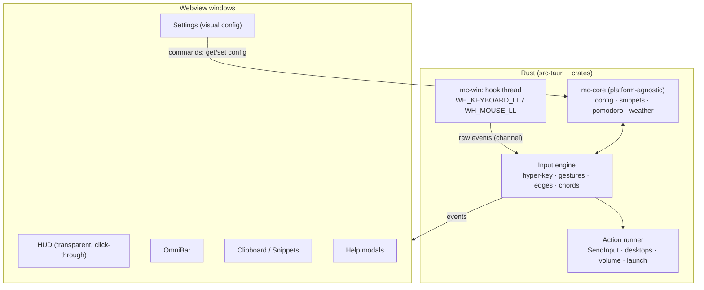

# MouseComb — App Spec (Single Source of Truth)

> **Rules for humans and AI agents**
> 1. Read this file and the latest entry in `DEVLOG.md` before changing anything.
> 2. Cite IDs (`FEAT-xxx`, `DEC-xxx`) when discussing or changing code.
> 3. If a change affects behavior, UI, config or status, update this file in the same change.
> 4. Log each work session in `DEVLOG.md`, not here.

---

## 1. Identity & stack

```yaml
name: MouseComb
tagline: "CapsLock Hyper-Key, safe mouse gestures, hot edges and an AMOLED HUD for Windows."
stage: pre-production          # see §8 for versioning rules
build: B-0001                  # manual build counter until production
targets:
  desktop: Windows 10/11 (x64) — first and only desktop target for v1
  mobile:  Android / iOS companion — planned, see §7
stack:
  shell:     Tauri v2
  core:      Rust (stable)
  win32:     `windows` crate (low-level hooks, SendInput, monitors, audio)
  frontend:  TypeScript + Vite + Svelte 5   # DEC-001, change before M0 if desired
  weather:   Open-Meteo REST (no API key)
config: JSON in the OS app-config dir (%APPDATA%\MouseComb\config.json), schema-versioned
```

### Design tokens

| Token | Value | Use |
|---|---|---|
| `bg.idle` | `#000000` | HUD background, AMOLED black |
| `bg.surface` | `#0E0E10` | Modals, settings panels |
| `bg.input` | `#18181B` | Inputs, list rows |
| `accent.run` | `#FF7A00` | Running timer, active zones, primary buttons |
| `accent.text` | `#1A1200` | Text on accent |
| `text.primary` | `#FFFFFF` | |
| `text.secondary` | `#888890` | |
| `radius.modal` / `radius.hud` | `14px` / `8px` | |
| `font` | Segoe UI Variable | Falls back to system UI font |

---

## 2. Architecture



**Hard rules for the input layer** (these make it "bulletproof"):
- Hook callbacks only copy the event into a channel and return. All logic runs on the engine thread. Windows silently removes a low-level hook if its callback is slow.
- The engine never leaves a key or button logically "held". Every suppressed down-event is either replayed or matched by a synthetic up-event, including on timeout, focus change and shutdown.
- Events we inject ourselves are tagged (`dwExtraInfo`) and ignored by our own hooks, so they never loop.
- **Global pause:** `CapsLock + Pause` (and a tray toggle) disables every input feature at once. The HUD keeps running.
- **Per-app exclusions:** a process list where gestures, edges and chords are off. Fullscreen-exclusive apps (games) are auto-excluded by default.

### Planned layout

```
MouseComb/
├─ APP_SPEC.md · DEVLOG.md · CLAUDE.md · README.md
├─ app/                 # frontend (one Vite app, one route per window)
├─ src-tauri/           # Tauri shell: windows, tray, commands, autostart
└─ crates/
   ├─ mc-core/          # pure Rust, no OS calls — reused by mobile
   └─ mc-win/           # Windows hooks, SendInput, monitors, audio, desktops
```

---

## 3. Feature registry

Status legend: `PLANNED` · `IN_PROGRESS` · `TESTING` · `DONE` · `DROPPED`.
All features restart as `PLANNED` in the Tauri rewrite. The AutoHotkey prototype proved the behavior of FEAT-001 to 003.

| ID | Feature | Trigger / entry | Milestone | Status |
|---|---|---|---|---|
| FEAT-000 | App shell: tray, autostart, single instance, config load/save + live reload | tray | M0 | PLANNED |
| FEAT-008 | CapsLock Hyper-Key engine | hold `CapsLock` | M1 | PLANNED |
| FEAT-009 | Help modals, generated from the live keymap | `Caps+/`, `Caps+Shift+/` | M1 | PLANNED |
| FEAT-001 | HUD clock + date with proximity fade | always on | M2 | PLANNED |
| FEAT-002 | HUD Pomodoro / stopwatch | `Ctrl+Click` on HUD | M2 | PLANNED |
| FEAT-003 | HUD weather (Open-Meteo) | 30 min poll | M2 | PLANNED |
| FEAT-006 | Mouse gestures (safe triggers only) | `Caps+LMB drag`; `RMB drag` opt-in | M3 | PLANNED |
| FEAT-011 | LMB-hold + scroll chord → Enter / Esc | opt-in | M3 | PLANNED |
| FEAT-007 | Hot edges & corners | scroll / dwell at screen edge | M4 | PLANNED |
| FEAT-010 | Visual Settings window (edges preview first) | tray, `Caps+,` | M4 | PLANNED |
| FEAT-004 | OmniBar launcher | `Caps+Space` | M5 | PLANNED |
| FEAT-005 | Clipboard history + snippets | `Caps+V` | M5 | PLANNED |
| FEAT-012 | Mobile companion | — | M7 | PLANNED |
| — | Window management (`Caps+P/M/G`) | — | — | DROPPED |
| — | Middle-button drag gestures | conflicts with autoscroll and panning | — | DROPPED |

### FEAT-008 — CapsLock Hyper-Key
- `CapsLock` is suppressed. While it is held, the next key goes to the MouseComb keymap and not to the app.
- Tap alone: nothing. Hold alone ≥ `hyper.capslock_toggle_ms` (default 1500): toggle real CapsLock, with a toast.
- The keymap lives in config (`keymap`). The help modals and Settings read the same map, so documentation can't drift from behavior.

### FEAT-009 — Help modals
- `Caps+/` → **Zen help**: a single centered card, top ~8 bindings, closes on any key.
- `Caps+Shift+/` → **Detailed help**: tabs for Keys · Mouse · Edges · Snippets, searchable.

### FEAT-001 / 002 / 003 — HUD
- Transparent, borderless, always-on-top, click-through window, bottom-right of the work area (multi-monitor: primary by default, configurable).
- **Proximity fade:** opacity follows the cursor's distance (cursor position comes from the mouse hook, no polling). Fully hidden within `hud.fade_near_px`, fully visible beyond `hud.fade_far_px`.
- **Holding Ctrl** makes the HUD visible and clickable. `Ctrl+LClick` on the timer starts or pauses it, `Ctrl+RClick` resets it, and `Ctrl+LClick` on the weather refreshes it.
- Timer: elapsed `mm:ss`, accent color while running. Optional Pomodoro mode (focus/break lengths in config) with a toast at the end.
- Weather: temperature + WMO icon, location in config (default Karachi 24.86, 67.01), shows `N/A` on failure and never blocks the UI.

### FEAT-006 — Mouse gestures (safe triggers)
**Principle:** only use triggers that no common app already uses, so existing habits keep working.

| Trigger | Default | Why |
|---|---|---|
| `CapsLock` held + LMB drag | **ON** | CapsLock is already ours. Caps+drag has no native meaning anywhere. |
| RMB drag | **OFF (opt-in)** | Popular and fast, but it fights apps that use RMB-drag (Explorer copy/move menu, CAD/3D panning, games, browser gesture extensions). When on: RMB-down is held back. If the cursor moves less than `gestures.threshold_px` before release, the click is replayed unchanged, so context menus still work. |
| `Ctrl+Shift` + drag | **not offered** | Already used: Explorer creates a shortcut, editors extend the selection, design tools constrain. |

- Directions: 4 orthogonal (Up/Down/Left/Right), with a dominant-axis ratio so diagonals are ignored rather than guessed.
- Default actions: Left = Back, Right = Forward, Up = next app (Alt+Tab), Down = previous app (Alt+Shift+Tab). Every direction can be remapped in Settings.
- Optional on-screen trail plus a direction hint while dragging (`gestures.show_trail`).
- Cancel: press Esc mid-drag, or return to the start point.
- Defaults: `threshold_px` 18, `axis_ratio` 2.0, `max_duration_ms` 1500.

### FEAT-011 — LMB + scroll chord
- Hold LMB + wheel down → `Enter`, wheel up → `Esc`.
- **Off by default**: holding LMB while scrolling is a real habit (extending a selection, dragging while scrolling). Per-app opt-in recommended.

### FEAT-007 — Hot edges & corners
- **Zones:** 4 edges + 4 corners per monitor. Only outer edges count, never the borders between two monitors.
- **Triggers per zone:** `scroll` (wheel while the cursor is in the zone) or `dwell` (cursor rests ≥ N ms, with a short cooldown).
- **Actions:** switch virtual desktop, volume ±/mute, media play/pause/next, show desktop, Task View, launch an app or URL, send a key combo.
- **Defaults (conservative):** left edge scroll = virtual desktop prev/next, right edge scroll = volume. All corners off.
- Zone thickness defaults to 2 px (edges) and 8×8 px (corners). Max cursor speed for dwell is configurable to prevent accidental triggers on fast moves.

### FEAT-010 — Visual Settings window
The whole point: **see a setting change while you change it.** Edges and corners come first; other sections follow the same pattern.
- **Monitor map:** live diagram of the real monitor layout (positions, sizes, primary). Edge and corner zones are drawn on it, colored by state (off, scroll, dwell).
- **Click a zone** to open its panel: trigger, action, thickness and dwell-time sliders. The diagram redraws as each slider moves.
- **"Show on screen" toggle:** temporarily draws the real zones as accent overlays on every monitor, plus a live readout of what the cursor would trigger right now.
- **Gesture preview:** an animated arrow per direction with its mapped action. The threshold slider shows the radius as a circle.
- **HUD preview:** fade-distance rings around a mock HUD.
- Every change saves instantly (debounced). Each section has **Undo** and **Reset**, and a corrupt config falls back to defaults with a warning.

### FEAT-004 — OmniBar (`Caps+Space`)
- Centered 460×120 modal. Input is matched in this order: keyword (`code`, `term`, `calc`, user-defined) → URL → app (fuzzy, from Start Menu shortcuts) → web search (engine in config).
- `Esc` closes. The previously focused window gets focus back.

### FEAT-005 — Clipboard & snippets (`Caps+V`)
- Two tabs: **History** (last `clipboard.max_items`, default 10, text only) | **Snippets**.
- Enter or double-click pastes into the window that had focus before (focus restored, then `Ctrl+V`).
- **Privacy:** skips clipboard data flagged by password managers (`ExcludeClipboardContentFromMonitorProcessing`). History lives in memory only unless `clipboard.persist` is on.
- Snippet tokens: `{DATE}` yyyy-MM-dd · `{TIME}` HH:mm:ss · `{USER}` · `{CLIPBOARD}` · `\n`.
- Seed snippets: date, timestamp, work-log line `[{TIME}] - #dev - | @30m`, SQL `SELECT … LIMIT 50` boilerplate.

---

## 4. Config schema (v1, abridged)

```jsonc
{
  "schema": 1,
  "paused": false,
  "exclusions": { "processes": [], "auto_fullscreen": true },
  "hyper":     { "capslock_toggle_ms": 1500 },
  "keymap":    { "/": "help.zen", "Shift+/": "help.detailed", "Space": "omnibar", "V": "clipboard", ",": "settings", "Pause": "pause.toggle" },
  "hud":       { "monitor": "primary", "fade_near_px": 60, "fade_far_px": 220, "pomodoro": { "enabled": false, "focus_min": 25, "break_min": 5 } },
  "weather":   { "lat": 24.86, "lon": 67.01, "label": "Karachi", "poll_min": 30 },
  "gestures":  { "caps_drag": true, "rmb_drag": false, "threshold_px": 18, "axis_ratio": 2.0, "max_duration_ms": 1500, "show_trail": true,
                 "actions": { "left": "nav.back", "right": "nav.forward", "up": "app.next", "down": "app.prev" } },
  "chords":    { "lmb_scroll": false },
  "edges":     { "edge_px": 2, "corner_px": 8, "dwell_ms": 350, "cooldown_ms": 600,
                 "zones": { "left": { "trigger": "scroll", "action": "desktop.switch" }, "right": { "trigger": "scroll", "action": "volume" } } },
  "omnibar":   { "search_url": "https://duckduckgo.com/?q={q}", "keywords": { "code": "code", "term": "wt", "calc": "calc" } },
  "clipboard": { "max_items": 10, "persist": false },
  "snippets":  [ { "id": "SNIP-001", "title": "Date", "text": "{DATE}" } ]
}
```

---

## 5. Windows & UI map

| Window | Size | Traits |
|---|---|---|
| HUD | ~160×170 | transparent, click-through (unless Ctrl held), always-on-top, no taskbar entry |
| OmniBar | 460×120 | centered, borderless, R14, hides on blur |
| Clipboard | 460×370 | centered, tabs History / Snippets |
| Help (Zen / Detailed) | 420×auto / 560×520 | centered, borderless |
| Settings | 960×640, resizable | normal window, sidebar sections, live previews |
| Edge overlay | per monitor | transparent, click-through, only while "Show on screen" is on |

---

## 6. Milestones

| M | Scope | Exit check |
|---|---|---|
| M0 | Tauri workspace, tray, single instance, config load/save/reload, empty Settings shell | `cargo tauri dev` runs; config round-trips |
| M1 | Hook thread, Hyper-Key, global pause, exclusions, help modals | No stuck keys in a 30-min stress session; typing unaffected |
| M2 | HUD: clock, fade, timer, weather | Fade is smooth; HUD never steals focus or clicks |
| M3 | Gestures (Caps-drag, RMB opt-in), LMB chord | RMB context menus work in Explorer, browsers and VS Code with RMB-drag on |
| M4 | Hot edges + visual Settings | Every edge setting can be changed and previewed without editing JSON |
| M5 | OmniBar, clipboard & snippets | Paste lands in the right window every time |
| M6 | Hardening → **production 1.0**: installer, autostart, elevation, signing, crash log | See §8 |
| M7 | Mobile companion | See §7 |

---

## 7. Mobile plan (FEAT-012)

Android and iOS don't let apps hook global input or draw over other apps (iOS not at all, Android only in limited ways). Hyper-key, gestures and edges are **desktop-only**. The mobile build is a **companion** that reuses `mc-core`:
- Clock / Pomodoro / weather screen (Tauri v2 mobile). Home-screen widgets need native Kotlin/Swift, so they come later.
- Snippet library with copy-to-clipboard.
- Read and edit the desktop config file (export/import file first; LAN/cloud sync is a later decision).
- Rule: no OS calls in `mc-core`, so it builds for every target.

---

## 8. Versioning policy

- **Pre-production (now):** no SemVer, tags or releases. Each work session bumps the manual build counter (`B-0001`, `B-0002`, …) in §1 and `DEVLOG.md`. Use git worktrees for parallel experiments (`git worktree add ../mc-<topic> -b wip/<topic>`). Merge or delete them, don't let them drift.
- **Production (from 1.0.0, end of M6):** SemVer, `CHANGELOG.md` (Keep a Changelog), annotated tags, GitHub Releases with signed installers, conventional commits, protected `main`. `DEVLOG.md` is then frozen as pre-history.

---

## 9. Open decisions

| ID | Question | Current default |
|---|---|---|
| DEC-001 | Frontend framework | Svelte 5 + TS (small, fast windows) |
| DEC-002 | Elevation: the hooks can't act on admin windows (Task Manager etc.) unless MouseComb is elevated too | Run normally. Optional "Start elevated" via a logon scheduled task (no UAC prompt every boot) |
| DEC-003 | Gesture Up/Down default: app switching vs. Task View / minimize | App switching |
| DEC-004 | Undefined prototype modules (`Plugins`, `StickyEngine`) | Parked until defined |
