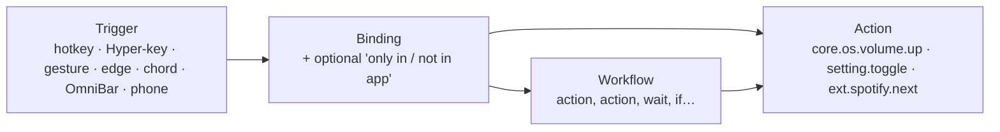
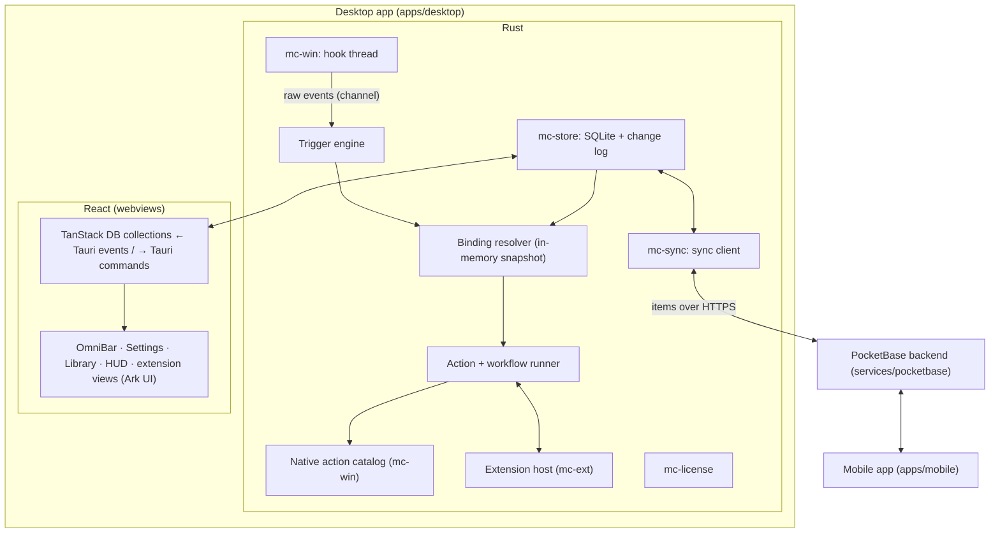

# MouseComb — App Spec (Single Source of Truth)

> **Rules for humans and AI agents**
> 1. Start at [`CR.md`](CR.md) (state, commands, rules). Read the part of this file you touch and the latest entry in [`DEVLOG.md`](DEVLOG.md) before changing anything.
> 2. Cite IDs (`FEAT-xxx`, `DEC-xxx`) when discussing or changing code.
> 3. If a change affects behavior, UI, data, config or status, update this file in the same change.
> 4. Log each work session in `DEVLOG.md`, not here.

---

## 1. Identity & stack

```yaml
name: MouseComb
tagline: "Bind any key, gesture or screen edge to any Windows command, setting or workflow. Add more with free extensions. Your setup follows you to every device."
stage: prototype               # numbered builds start at 0.0.0+1 (pre-release); production is 1.0.0 (M9)
version: 0.1.0+2               # x.y.z+b (CR.md, Versioning); bump at the end of every session
product: Free edition + paid Pro edition (see §9)
targets:
  desktop: Windows 10/11 (x64, later ARM64) — first desktop target
  linux:   Linux x64 (AppImage, .deb, .rpm; X11 for the global shortcut) — second production target (DEC-024)
  mobile:  Android + iOS companion app (see §12)
  later:   macOS desktop (needs its own input adapter; everything else is shared)
```

| Layer | Choice | Why |
|---|---|---|
| App shell | **Tauri v2** + official plugins (DEC-008) | Small native installer, tray, updater, autostart; same project builds Android/iOS |
| Core language | **Rust** (stable), Cargo workspace | Fast, memory-safe; one core for desktop and mobile |
| Windows access | `windows` crate | Low-level hooks, SendInput, audio, monitors, radios |
| UI framework | **React 19 + TypeScript + Vite** (DEC-001) | Largest ecosystem, shared by desktop, mobile and extension views |
| UI components | **Ark UI** (React components built on **Zag.js** state machines); raw `@zag-js/*` machines for custom widgets | Accessible, keyboard-complete, predictable state; headless so it takes our design |
| Styling | Tailwind CSS v4 with MouseComb tokens as CSS variables | Fast to build, themeable, tiny output |
| Icons | Small built-in set in `packages/ui` (Fluent line style) | Native look without a multi-megabyte icon package |
| Routing | **TanStack Router** | Type-safe routes and search params, one route per window |
| Live data | **TanStack DB** collections backed by the Rust store; **TanStack Query** for one-off calls | Live queries and optimistic edits; the Rust core stays the source of truth |
| Tables & lists | **TanStack Table** + **TanStack Virtual** | Bindings table, action log, OmniBar and clipboard lists with thousands of rows |
| Forms | **TanStack Form** + Zod 4 | Settings and extension-settings forms, generated from schemas |
| Timing | **TanStack Pacer** | Debounced saves, throttled live previews |
| Rust ↔ TS types | `tauri-specta` | Commands and events are typed end to end, no hand-written glue |
| Desktop plugins | global-shortcut, updater (signed), notification, clipboard-manager, autostart, single-instance, opener | OmniBar hotkey, updates, Pomodoro toasts, copy results; all used from Rust, not from the webviews |
| Local data | SQLite (`rusqlite`, bundled) in `mc-store` | Same database file format on every device; dirty flags for sync |
| Backend | **PocketBase v0.40** embedded as a Go framework (`services/pocketbase`) (DEC-010) | Free, open source, one small binary with auth, REST and realtime; you own the data |
| Sync | `mc-sync`: `Backend` trait + PocketBase adapter, per-record last-writer-wins | Same data on every PC and the phone; another backend (e.g. Firebase) plugs in behind the trait |
| Extensions | TypeScript on embedded QuickJS (`rquickjs`), views written in JSX (DEC-005) | Easy to write, sandboxed, fast to start |
| Weather | Open-Meteo REST (no API key) | In the bundled Weather extension |
| Tests | `cargo test` (incl. live backend tests), Vitest, Playwright screenshots of the UI with a mock backend | |

### Design tokens

| Token | Value | Use |
|---|---|---|
| `bg.idle` | `#000000` | HUD background, AMOLED black |
| `bg.surface` | `#0E0E10` | Modals, settings panels |
| `bg.input` | `#18181B` | Inputs, list rows, cards inside a card |
| `bg.card` | `#121214` | Settings cards |
| `bg.face` / `bg.button` | `#141417` / `#1C1C20` | Timer dial face, round buttons |
| `line` / `tick` | `#2A2A30` / `#45454E` | Borders / unlit dial ticks |
| `accent.run` | `#FF7A00` | Running timer, active zones, primary buttons |
| `accent.text` | `#1A1200` | Text on accent |
| `text.primary` | `#FFFFFF` | |
| `text.secondary` | `#888890` | |
| `radius.modal` / `radius.hud` | `14px` / `8px` | |
| `font` | Segoe UI Variable | Falls back to system UI font (mobile: platform font) |

Tokens live once in `packages/ui/tokens.css` and are shared by desktop, mobile and extension views.

---

## 2. The model: triggers → bindings → actions

Everything MouseComb does is an **action** with an ID. Anything that starts an action is a **trigger**. A **binding** connects the two, optionally only in certain apps. A **workflow** is a saved list of actions that is itself an action.



- The core ships the triggers, a catalog of native Windows actions, setting actions, and the workflow runner.
- Extensions only add **actions, OmniBar commands, settings, views and HUD widgets**. They never get raw keyboard or mouse hooks.
- Anything can be bound to anything. Defaults are just a preset bindings set.

---

## 3. Architecture



**Hard rules for the input layer** (these make it "bulletproof"):
- Hook callbacks only copy the event into a channel and return. All logic runs on the engine thread. Windows silently removes a low-level hook if its callback is slow.
- The binding resolver reads an **in-memory snapshot**. No database, network, license or extension call ever happens on the input path.
- **Extensions are never on the input path.** Running the matched action, including extension code, happens afterwards, asynchronously.
- The engine never leaves a key or button logically "held". Every suppressed down-event is either replayed or matched by a synthetic up-event, including on timeout, focus change and shutdown.
- Events we inject ourselves are tagged (`dwExtraInfo`) and ignored by our own hooks, so they never loop.
- **Off by default, panic key (DEC-025):** hotkey bindings, the Hyper-Key and gestures run only while the device-only setting `input.enabled` is on (Settings → Bindings). `Ctrl+Alt+Pause` is a plain registered shortcut, so it works even if a hook misbehaves: it turns `input.enabled` off, stops any snippet being typed and releases everything held. A tray toggle is planned.
- **Per-app exclusions:** a process list where gestures, edges and chords are off. Fullscreen-exclusive apps (games) are auto-excluded by default.

### Repository layout (monorepo: pnpm workspaces + Cargo workspace)

```
MouseComb/
├─ APP_SPEC.md · DEVLOG.md · CLAUDE.md · README.md
├─ apps/
│  ├─ desktop/          # Tauri v2 Windows app: src-tauri/ (Rust shell) + src/ (React, TanStack Router)
│  └─ mobile/           # Tauri v2 Android/iOS app (React)
├─ packages/
│  ├─ ui/               # design system: tokens, Tailwind preset, Ark UI components styled for MouseComb
│  ├─ data/             # TanStack DB collections + Query hooks over Tauri commands (shared by desktop + mobile)
│  ├─ bindings/         # TypeScript types generated from Rust by tauri-specta
│  └─ api/              # @mousecomb/api extension SDK + `mc` CLI
├─ crates/
│  ├─ mc-core/          # no OS calls: data model, merge rule, ids (later: binding resolver, workflow engine)
│  ├─ mc-store/         # SQLite schema, migrations, dirty tracking
│  ├─ mc-sync/          # Backend trait, PocketBase adapter, sync pass
│  ├─ mc-license/       # (M7) license verification
│  ├─ mc-win/           # Windows only: installed apps + power (M1); hooks, SendInput, native catalog (M3)
│  └─ mc-ext/           # (M4) extension host: QuickJS sandbox, permissions, host API
├─ extensions/          # (M4) bundled extensions (clock, pomodoro, weather, clipboard, snippets)
└─ services/
   └─ pocketbase/       # the backend: auth, items, devices; deploy notes in its README
```

---

## 4. UI layer

### Windows (each is a TanStack Router route in one React app)

| Window | Route | Traits |
|---|---|---|
| HUD (`hud`) | `/hud` | transparent, click-through (Ctrl to click arrives in M3), always-on-top, not focusable, no taskbar entry |
| OmniBar (`omnibar`) | `/omnibar` | borderless, transparent, near the top of the screen with the mouse; hides on blur (after a 400 ms grace) and on Esc |
| Settings (`main`) | `/general`, `/pomodoro`, `/snippets`, `/account`, `/about` under a pathless `_settings` layout; later bindings, workflows, edges, gestures, extensions, library | normal window, sidebar |
| Welcome (`main`) | `/welcome` | first launch only (FEAT-021) |
| Library | `/settings/library` | browse / install extensions |
| Help | `/help/zen`, `/help/all` | centered, borderless |
| Edge overlay | `/overlay` | per monitor, only while "Show on screen" is on |

Windows are created at startup and hidden, so showing one is instant. They are created in Rust's setup after the app state exists (`"create": false` in tauri.conf.json), because their pages call commands as soon as they load. A page that fails to load shows the reason and **Try again** (`ErrorPage`). Each route's code is loaded only by the window that shows it. Rust events reach every window, so window-specific listeners check which window they're in.

### Which tool does what

| Need | Tool | Example |
|---|---|---|
| Interactive component behavior | Ark UI (Zag machines) | Combobox for the OmniBar, Slider for edge sizes, Dialog, Menu, Tabs, Toast, Tooltip, Tree View for workflows, Tour for onboarding, Splitter, Floating Panel |
| Custom widget behavior | `@zag-js/*` machine directly | Key recorder, gesture preview, monitor map |
| Live app data | TanStack DB | `bindings`, `workflows`, `snippets`, `extensions` collections with live queries |
| One-off calls | TanStack Query | weather fetch, library index, license status |
| Big tables | TanStack Table + Virtual | bindings table (filter by app, trigger, extension), action log |
| Big lists | TanStack Virtual | OmniBar results, clipboard history |
| Forms | TanStack Form + Zod 4 | settings sections, extension settings generated from manifest schemas |
| Debounce/throttle | TanStack Pacer | save 300 ms after the last change; throttle slider previews to 60 fps |

### Native Windows feel
- Mica (Settings) and Acrylic (OmniBar) backdrops through Tauri window effects, Windows 11 rounded corners, Segoe UI Variable, Fluent icons.
- Native tray menu, native toasts, native file dialogs, "start with Windows", follows the system light/dark mode and accent color where it fits the brand.
- Keyboard-complete: every screen works without a mouse (Ark/Zag handle focus and keyboard rules).

### Data flow between Rust and React
- Rust is the source of truth. `packages/data` defines TanStack DB collections whose **sync** subscribes to typed Tauri events (`bindings_changed`, …) and whose **onInsert / onUpdate / onDelete** call typed Tauri commands.
- React screens use live queries, so a change made by a hotkey, a workflow, an extension or another device (via sync) appears on screen immediately.
- The mobile app uses the same `packages/data` against its own local store.

---

## 5. Data & sync (FEAT-020)

### What's stored where
All user data lives in one SQLite database per device (`%APPDATA%\com.mousecomb.app\mousecomb.db` on Windows). Import/export as readable JSON is planned.

| Record type | Synced across devices? |
|---|---|
| Bindings, workflows, snippets | yes |
| Settings | yes, except those marked **this device only** (HUD monitor, edge geometry, script paths, exclusions) |
| Installed extensions list + their settings | yes (extensions install on each desktop by themselves) |
| Clipboard history | **off by default**; opt-in, and only once end-to-end encryption exists (DEC-014) |
| Pomodoro sessions, action log | stats yes / log no |
| License | no (per device, see §9) |

### How sync works (built in B-0004)
- **Backend:** one `items` collection in PocketBase holds every synced record of every user (`user`, `kind`, `key`, `data`, `mtime`, `deleted`, `device`). API rules let each account see and change only its own rows. New kinds (for example an extension's data) need no server change.
- **Record ids** are derived from user + kind + key (`mc_core::remote_id`), so two devices that create the same setting write the same record.
- **Merge rule: last writer wins per record**, by the editing device's `mtime`. Ties are settled by device id, so every device reaches the same answer. The server enforces it too: an update older than the stored copy is rejected with `409`. Deletes are tombstones.
- **A sync pass:** pull everything changed since the last cursor (`updated`, `id`, keyset paging), merge it, then push local items marked dirty. Interrupted passes resume safely.
- **When:** at startup, about 1.5 s after a local change, every 60 s, and on "Sync now". Edits made during a pass trigger another pass.
- **Sign-in:** local data made while signed out (or with another account) is queued to join the account. Sign-out can keep or remove data on the PC.
- **Session:** the sign-in token lives in Windows Credential Manager and refreshes daily; an expired session signs out with a clear message.
- **Rate limits:** the server limits sign-in attempts; the client waits and retries, then shows "Too many attempts".
- **Privacy today:** data is protected by HTTPS (in production) and per-account rules, but whoever runs the server can read it. End-to-end encryption, QR pairing and a recovery phrase come before clipboard sync ships (DEC-014).
- **Free vs Pro:** sync is free during pre-production; Pro gating arrives with licensing in M7 (DEC-009).
- **Realtime:** PocketBase's realtime subscriptions will replace the 60 s poll in a later build.

### Phone → desktop actions
- The phone can ask a desktop to run a workflow or action. It writes a "run request" record, and the desktop receives it through sync.
- Only workflows you mark **Allow from phone** can run this way. Each request shows a toast on the desktop and lands in the action log.

---

## 6. Core shell — feature registry

Status legend: `PLANNED` · `IN_PROGRESS` · `TESTING` · `DONE` · `DROPPED`.

| ID | Feature | Milestone | Status |
|---|---|---|---|
| FEAT-000 | App shell: tray, autostart, single instance, store, windows pre-created | M0 | IN_PROGRESS (all but extra windows) |
| FEAT-008 | CapsLock Hyper-Key | M1 | TESTING (built in 0.1.0+2, Windows hooks; logic unit-tested, not yet run on real Windows) |
| FEAT-013 | Action registry + native Windows action catalog + setting actions | M1 → M3 | IN_PROGRESS (runner + the actions the OmniBar and bindings need: send keys, volume, media, desktops, snippet typing, input toggle; full catalog M3) |
| FEAT-014 | Trigger & binding system (any trigger → any action, per-app conditions) | M1 | TESTING (0.1.0+2: hotkey, Hyper and gesture triggers, `only_in`/`not_in`, Settings → Bindings) |
| FEAT-004 | OmniBar: command palette (opens Settings, runs quick commands, bangs, later every action) | M1 | TESTING (built B-0007, bangs 0.1.0+2, verified on Linux; needs a Windows run) |
| FEAT-009 | Help modals, generated from the live bindings | M2 | PLANNED |
| FEAT-010 | Settings window: bindings editor, recorder, conflict check, visual previews | M2 → M5 | IN_PROGRESS (shell; General: shortcut, search engine, clock faces with preview and fade presets, Basics; Pomodoro: dial, steppers; Snippets, Account, About with updates. Visual redesign B-0009) |
| FEAT-015 | Workflows | M3 | PLANNED |
| FEAT-016 | Extension host + SDK + permissions | M4 | PLANNED |
| FEAT-018 | Script commands | M4 | PLANNED |
| FEAT-001 | HUD with Clock widget, proximity fade | M1 | TESTING (built B-0007; Ctrl-click waits for the M3 input engine) |
| FEAT-006 | Mouse gesture trigger (safe triggers only) | M5 | TESTING (built early in 0.1.0+2, Windows hooks; not yet run on real Windows) |
| FEAT-007 | Hot edge & corner trigger | M5 | PLANNED |
| FEAT-011 | LMB-hold + scroll chord trigger (opt-in) | M5 | PLANNED |
| FEAT-017 | Extension library (free, in-app store) | M6 | PLANNED |
| FEAT-019 | Editions, licensing, purchase, account | M7 | PLANNED |
| FEAT-020 | Data store, account and sync (E2E encryption later) | M0 | IN_PROGRESS (store, auth, sync done; realtime, E2E, export pending) |
| FEAT-012 | Mobile app | M10 | PLANNED |
| FEAT-021 | Sign-in page on first launch | M1 | TESTING (built B-0007, with password reset) |
| FEAT-022 | Installer + auto-updates + What's New page | M1 | IN_PROGRESS (updater built B-0007, update feed on the fixed `updates` release and What's New in 0.1.0+2; first signed release waits for the owner's setup) |
| FEAT-023 | Quick commands: calculator, app launcher, web search, copy a snippet | M1 | TESTING (built B-0007; app list and power actions need a Windows run) |
| FEAT-002 | Pomodoro (core in M1, extension in M5) | M1 | TESTING (built B-0007, full phase verified on Linux) |
| FEAT-024 | Usage telemetry, collected by the app | M2 | PLANNED (consent switch built B-0007, on by default, DEC-018) |
| FEAT-026 | Insights add-on (`services/insights`): health, trends, basic ML, weekly report | M2 | PLANNED |
| FEAT-027 | Staged rollout: updates reach 10 % → 50 % → 100 %, paused on worse health | M2 | PLANNED |
| FEAT-028 | Delivery pipeline: CI, owner-approved merges, gated release ([`PIPELINE.md`](PIPELINE.md)) | B-0006 (built) → M1 (switched on) | IN_PROGRESS |
| FEAT-025 | Release automation: version and notes from `CHANGELOG.md` `## Next`, hotfix without a branch, tags (`scripts/version.mjs`, DEC-026) | B-0006 → 0.1.0+2 | DONE (used for 0.0.0+1; changelog-driven from 0.1.0+2) |
| — | Window management (`Caps+P/M/G` and all window actions) | — | DROPPED (DEC-007) |
| — | Middle-button drag gestures | — | DROPPED (conflicts with autoscroll and panning) |

### Bundled extensions (ship with the app, removable, built on the public API)

| ID | Extension | Contributes | Permissions |
|---|---|---|---|
| FEAT-001b | `mc.clock` | HUD widget: time + date (built in M1 inside the core, moved behind the extension API in M5) | — |
| FEAT-002 | `mc.pomodoro` | HUD widget, OmniBar timer view, start/pause/toggle/skip/reset/extend actions (`ext.mc.pomodoro.*`), toast, synced sessions (built in M1 inside the core, moved in M5) | notifications |
| FEAT-003 | `mc.weather` | HUD widget, refresh action | network: api.open-meteo.com |
| FEAT-005a | `mc.clipboard` | `Caps+V` view, history, paste action | clipboard:read, keys:send |
| FEAT-005b | `mc.snippets` | snippet list, insert action, `{DATE}` `{TIME}` `{USER}` `{CLIPBOARD}` tokens (data + editor built in B-0004 as core) | clipboard:write, keys:send |

---

## 7. Core details

### FEAT-013 — Actions
An action has an `id`, a title, typed parameters, and an optional "needs confirmation" flag. Every action shows up in the OmniBar, the binding editor and the workflow editor.

**Native Windows catalog (`core.os.*`), v1:**

| Group | Actions | Notes |
|---|---|---|
| Input | send keys, type text, mouse click / move / scroll | tagged, never re-triggers MouseComb |
| Apps | launch, focus-or-launch, close, kill | kill asks for confirmation |
| Desktops | next / prev / go to N, Task View | uses Windows' own shortcuts |
| Audio & media | volume ± / set / mute, mic mute, play/pause/next/prev | output-device switching needs an undocumented API, later |
| Display & system | brightness (laptops), dark/light mode, Wi-Fi / Bluetooth on/off, Night light *(deep link only)* | public APIs where they exist, otherwise opens the right Settings page |
| Windows Settings | open any page (`ms-settings:bluetooth`, `ms-settings:display`, …) | full list of pages in the picker |
| Power | lock, sleep, sign out, restart, shut down | everything but lock asks for confirmation |
| Shell | open file / folder / URL, run command, run PowerShell | permission-gated for extensions |
| Clipboard | get / set text | |
| Notify | toast, HUD flash | |

**Built so far (ids in `mc_core::actions`):** `core.os.input.send` (a key combo, used by the volume, media and desktop actions), `core.os.audio.{volume_up,volume_down,mute}`, `core.os.media.{play_pause,next,prev}`, `core.os.desktops.{next,prev}` (`Ctrl+Win+→/←`), `ext.mc.snippets.type`, `mc.input.toggle`, plus the earlier OmniBar, Pomodoro, power, clipboard and open-URL actions.

**Setting actions (`setting.*`):** every MouseComb and extension setting automatically gets `setting.toggle`, `setting.set`, `setting.cycle`.

**MouseComb actions (`mc.*`):** open OmniBar, settings, help, pause/resume, reload, show bindings for the current app, sync now.

### FEAT-014 — Triggers & bindings
- **Trigger types, v1:** hotkey, Hyper-key combo, key sequence (`Caps`, then `G`, then `C`), gesture, hot edge / corner, mouse chord, OmniBar alias, **phone request** (FEAT-020).
- **Pro triggers:** schedule (time of day, interval), system events (app opened or focused, monitor connected, wake from sleep, network change).
- **Conditions per binding:** `only in` / `not in` a list of apps (by process name).
- **Binding editor:** press-to-record, a plain-English summary, live conflict warnings (with another binding, with known Windows or app shortcuts), import / export.
- Reserved, can't be rebound: `Ctrl+Alt+Del`, `Win+L`.
- **Built (0.1.0+2):** items of kind `binding` (synced, no migration): `{title, trigger, action, with, only_in, not_in, enabled}`. Trigger text: `hotkey:Ctrl+Alt+P`, `hyper:K`, `gesture:caps:left` (`mc_core::bindings::Trigger`). The resolver reads an in-memory snapshot and an app-specific binding beats a general one; disabled or invalid ones are skipped and reported in `InputStatus.issues`. Hotkeys register through the global-shortcut plugin (one handler each), so they work on Linux/X11 too; Hyper and gesture triggers need the Windows hooks. Known limit: a hotkey with `only_in` still takes the key in other apps (the plugin swallows it); resolving in the hook is planned. Settings → Bindings records the shortcut, picks the action (snippets included), warns about duplicate triggers, and holds the master switch.

### FEAT-008 — CapsLock Hyper-Key
- `CapsLock` is suppressed. While it is held, the next key goes to the bindings, not to the app.
- Tap alone: nothing. Hold alone ≥ `hyper.capslock_toggle_ms` (default 1500): toggle real CapsLock, with a toast.
- **Built (0.1.0+2):** `mc_core::input::Engine` (pure, runs inside the hook callback) with a `Ledger` that never suppresses an up whose down passed; the Windows side is `mc-win::hooks` on its own thread. Off until `input.enabled` and `input.hyper` are on (DEC-025).

### FEAT-004 — OmniBar (`Alt+Space` in M1, `Caps+Space` from M3)
- One place for everything: actions, workflows, extension commands, installed apps (Start Menu), URLs, calculator, web search. Built on Ark Combobox (always open) + TanStack Virtual, as `CommandPalette` in `packages/ui`.
- **Shortcut:** setting `omnibar.hotkey`, default `Alt+Space` (DEC-016), recorded in Settings → General. If another app owns it, Settings says so. Pressing it again closes the OmniBar.
- **Ranking:** prefix > word start > initials (`vsc`) > substring > letters in order; keywords count at 70 %; recent runs (device-only `omnibar.recents`, 20) get a boost and fill the empty state. Ties keep catalog order.
- **Typed-in results first:** a calculator result, then a web address (`github.com/x`), and always last "Search the web" (`omnibar.search_url`, default DuckDuckGo).
- **Destructive commands** (sleep, sign out, restart, shut down) need a second Enter; Rust refuses them without `confirmed`.
- Hover only highlights after the mouse moves, so a window opening under a resting mouse keeps the top result.
- `Esc` clears the text, then closes. Focus returns to the previous window. After a command runs, the OmniBar closes itself (`omnibar_hide`) and the HUD flashes a short confirmation ("Copied").
- **Views:** `mc.omnibar.open` with `view` opens the OmniBar on a view instead of the list (allow-list `OMNIBAR_VIEWS`); "Pomodoro timer" in the list does the same in place. The **Pomodoro timer view** (design: "OmniBar · Pomodoro timer") has a 60-minute dial with the time left (a tick per minute, a dot per half minute, quarter numbers, an inner arc to the exact time) and a raised start/pause button in the middle, the countdown, Now / Next / After N cards (cards further ahead are blurred: not started yet), and +5 min, Skip, Reset. Keys: `Space` start/pause, `S` skip, `R` reset, `+` add 5 min, `Esc` back to the list. Its buttons keep the OmniBar open.
- **Bangs (0.1.0+2):** `!yt cats` or `cats !yt` searches that site; about 60 are built in (`omnibar/bangs.ts`), your own are items of kind `bang` (trigger, name, address with `{q}`; Settings → General → Bangs) and win over the built-in ones; any other bang goes to DuckDuckGo. A bang result comes first, ahead of the calculator.
- **Snippet typing:** a snippet result offers *Type “title”* (`ext.mc.snippets.type`): the OmniBar hides, then Windows types the text with `SendInput` (Unicode, no clipboard, stops on the panic key); on Linux it copies and says to press `Ctrl+V`.
- Later: each result shows its current hotkey; extension commands open views inside it; a converter ([`BACKLOG.md`](BACKLOG.md)).

### FEAT-023 — Quick commands (M1)
| Command | How |
|---|---|
| Calculator | Own parser, no `eval`: `+ − × ÷ ^ ( )`, `200 * 15%` = 30, `x + 12%` adds 12 %, `pi`, `e`, sqrt/abs/round/floor/ceil/sin/cos/tan/log/ln, `2pi`. A bare number isn't a sum. Enter copies the result. |
| Apps | `Get-StartApps` (desktop and Store apps, as Start shows them; uninstallers hidden), cached; first scanned 30 s after start, then again when the OmniBar opens and the list is over 15 min old. Launch via `explorer.exe shell:AppsFolder\<AppID>`; AppIDs with quotes or control characters are refused. (DEC-023) |
| Snippets | Copies the snippet with `{DATE}` `{TIME}` `{USER}` `{CLIPBOARD}` filled in (`mc_core::fill_snippet`). Typing it into the app needs `keys:send` (M3). |
| Web | Web addresses open in the browser; anything else can be searched on the web. Only `http(s)` URLs open. |
| Windows Settings | 8 common `ms-settings:` pages from an allow-list. |
| Power | Lock (`LockWorkStation`), sleep (`SetSuspendState`), sign out / restart / shut down (`shutdown.exe`). All but lock confirm first. |
| MouseComb | Open Settings or any of its pages, Sync now, Check for updates / Restart to update, show or hide the clock (`setting.toggle`), Quit, Pomodoro timer view, Pomodoro start/pause, skip, add 5 minutes, reset. |

### FEAT-002 — Pomodoro (M1, in the core)
- Timer is a pure state machine in `mc_core::pomodoro` (time passed in; "running" is simply `ends_at` being set), saved on each change to the device-only `pomodoro.state`, so it survives a restart. The desktop task sleeps while the timer is stopped and wakes at least once a second while it runs.
- Settings (synced): `pomodoro.focus_min` 25, `short_break_min` 5, `long_break_min` 15, `long_break_every` 4, `auto_start` false. New lengths apply to a phase that hasn't started.
- **+5 min** (`ext.mc.pomodoro.extend`, optional `minutes` 1–60, default 5) adds time to the current phase, running or not, up to 3 h left; an extended phase keeps its length when durations change.
- When a phase ends: a notification; a finished focus phase is saved as a synced item of kind `pomodoro` (`started_at`, `ended_at`, `minutes`) for stats. After sleep, only one phase ends (the next one counts from wake-up).
- Shown in the HUD, the OmniBar ("Pause Pomodoro · Focus 12:03 left", and the timer view, FEAT-004), the tray, and Settings → Pomodoro: the same dial with start/pause in the middle, Skip, Reset, sessions today and focus minutes in the last 7 days; "Your rhythm" with −/+ steppers for the three lengths (the current phase's card is highlighted), "Long break after" 2–6 as number circles, and the auto-start switch.

### FEAT-021 — First launch (M1)
- The main window opens on `/welcome` until the user signs in, creates an account or picks **Use offline** (device-only `onboarding.done`). Signed-in devices skip it.
- Two switches on the same page: start with Windows (on) and share anonymous usage counts (on, DEC-018).
- **Forgot password?** asks the server to email a reset link (PocketBase `request-password-reset`; same answer whether or not the account exists). The server needs SMTP set up to send it.

### FEAT-009 — Help modals
- `Caps+/`: the top ~8 bindings for the **current app**. `Caps+Shift+/`: every binding, searchable, grouped by trigger type.

### FEAT-015 — Workflows
A workflow is a list of steps stored in the database, edited in a visual step editor (Ark Tree View + drag to reorder).

```jsonc
{
  "id": "wf.focus-mode",
  "title": "Focus mode",
  "allow_from_phone": true,
  "steps": [
    { "action": "core.os.audio.mute" },
    { "action": "setting.set", "with": { "key": "edges.enabled", "value": false } },
    { "action": "ext.mc.pomodoro.start" },
    { "action": "core.os.apps.focus_or_launch", "with": { "exe": "Code.exe" } },
    { "if": { "app_running": "Spotify.exe" }, "then": [ { "action": "core.os.media.pause" } ] },
    { "wait_ms": 300 },
    { "action": "core.os.notify.toast", "with": { "text": "Focus on. {pomodoro.remaining} left." } }
  ]
}
```

- Steps: action, `wait_ms`, `if` (app running, app focused, setting value, time between), `ask` (pick from a list in the OmniBar, store as variable).
- Variables: `{clipboard}`, `{selection}` (copied safely and restored), `{date}`, `{time}`, step outputs.
- Runs off the input thread. A failing step stops the workflow with a toast naming the step. `mc.workflow.stop_all` is always available.

### FEAT-016 — Extensions
**What an extension is:** a folder with `manifest.json` and a bundled `main.js`, written in TypeScript with the SDK.

```jsonc
{
  "id": "com.example.spotify",
  "name": "Spotify Controls",
  "version": "1.2.0",
  "api": 1,
  "permissions": ["network:api.spotify.com", "notifications"],
  "contributes": {
    "actions":  [ { "id": "like-current", "title": "Like current song" } ],
    "commands": [ { "id": "search", "title": "Search Spotify", "view": "list" } ],
    "settings": [ { "key": "market", "type": "string", "default": "US" } ],
    "widgets":  [ { "id": "now-playing", "slot": "hud" } ],
    "suggested_bindings": [ { "trigger": "hyper+L", "action": "like-current" } ]
  }
}
```

- **Runtime:** each extension runs in its own QuickJS context inside `mc-ext`, with memory and CPU-time limits. A runaway extension is stopped and reported.
- **Views in JSX:** authors write `<List>`, `<List.Item>`, `<Detail>`, `<Form>`, `<Widget>` in JSX. The SDK turns them into a view tree, and MouseComb draws it with its own Ark UI components. Extensions look native and can't draw over your screen.
- **Host API (`@mousecomb/api`):** `actions.run`, `settings`, `storage` (per extension, synced), `http.fetch` (allowed domains only), `clipboard`, `notify`, `hud.update`, `ui.show`.
- **Suggested bindings** are offered at install. Nothing is bound without the user saying yes.
- **SDK CLI:** `mc new`, `mc dev` (hot reload into the running app), `mc build`, `mc publish` (opens a PR to the library).

**Permissions** (approved at install; a new version that asks for more needs re-approval):

| Permission | Allows | Risk |
|---|---|---|
| `network:<domain>` | HTTP to that domain only | low |
| `notifications` | toasts | low |
| `clipboard:read` / `clipboard:write` | read / write clipboard | medium |
| `keys:send` | type text and send key combos via core actions | medium |
| `apps:launch` | start apps, open files and URLs | medium |
| `files:<path>` | read/write inside a chosen folder | medium |
| `shell` | run commands / PowerShell | high, human review |

### FEAT-018 — Script commands
- Drop a `.ps1`, `.py`, `.bat`, `.cmd` or `.ahk` file with a header comment into `scripts/` and it becomes an action.
- Runs as a normal process with your rights: **local only**, never in the library, marked "unsandboxed". Script files are not synced (paths differ per PC); their bindings are.

```powershell
# @mc.title   Restart audio service
# @mc.confirm true
Restart-Service Audiosrv
```

### FEAT-017 — Extension library
- Free and open source: one public GitHub repo (`mousecomb-extensions`, DEC-006), one folder per extension.
- Publishing = pull request. CI checks the manifest, permissions, bundle size and API version, builds the bundle and records its SHA-256. A human approves every `shell` permission.
- The in-app **Library** browses the index (search, categories, screenshots, permission badges), installs in one click, verifies the hash, and auto-updates.
- **Developer mode:** load an unpacked extension from a folder, with a persistent "unverified" badge.
- Paid extensions: not in v1 (DEC-012).

### FEAT-001 — HUD host
- Transparent, borderless, always-on-top, click-through window, bottom-right of the primary screen's work area, sized and placed by Rust for the clock style (digital 160×90, analog 128×128, `overlays::hud_size`) so placement works before the window exists natively; re-placed every 10 s for screen changes. The page draws in a box of that size at the window's top-left (Linux never makes a webview window smaller than 200×200). Shows widgets from extensions (clock, pomodoro, weather by default) in the order you choose.
- **M1:** the clock face you pick (`hud.style` analog or digital; `hud.dial_face` Minimal, Classic, Sport or Orbit; `hud.digital_face` Stacked, Bold, Pill or LCD; locale time format, seconds optional as a second hand or `:ss`), with a status line above it for the Pomodoro countdown while a timer is running or paused and 1.8 s flashes from actions. `hud.enabled` shows or hides it (Settings, OmniBar, tray). Rust polls the cursor at 20 Hz only while the HUD is visible (the loop sleeps otherwise), measures against the HUD's known position, and sends an opacity only when it changes.
- **Proximity fade:** opacity follows the cursor's distance. Hidden within `hud.fade_near_px`, fully visible beyond `hud.fade_far_px`. Settings offers three presets: Close (40/140), Medium (60/220, default), Far (100/320); a live preview shows the face and both zones.
- **Holding Ctrl** makes it clickable. A widget's `Ctrl+click` / `Ctrl+right-click` run actions it declares.

### FEAT-006 — Gesture trigger (safe triggers)

| Trigger | Default | Why |
|---|---|---|
| `CapsLock` held + LMB drag | **ON** | CapsLock is already ours. Caps+drag has no native meaning anywhere. |
| RMB drag | **OFF (opt-in)** | Fights apps that use RMB-drag. When on, RMB-down is held back; if movement stays under `gestures.threshold_px`, the click is replayed unchanged so context menus still work. |
| `Ctrl+Shift` + drag | **not offered** | Explorer creates shortcuts, editors extend selections, design tools constrain. |

- 4 directions with a dominant-axis ratio (diagonals are ignored rather than guessed), Esc or returning to the start cancels, optional trail.
- **Built (0.1.0+2):** `GestureTracker` in `mc_core::input` (threshold 18 px, axis ratio 2.0, 1500 ms, out-and-back cancels, a click replayed when nothing moved). Device-only setting `input.gestures` = `off` (default), `caps` or `rmb`. Windows only; the trail is not built.
- Default bindings: Left = Back, Right = Forward, Up = next app, Down = previous app. Defaults: `threshold_px` 18, `axis_ratio` 2.0, `max_duration_ms` 1500.

### FEAT-007 — Hot edge & corner trigger
- 4 edges + 4 corners per monitor. Only outer edges count, never the borders between two monitors.
- Each zone has **scroll-up**, **scroll-down** and **dwell** triggers.
- Defaults: left edge scroll = desktop prev/next, right edge scroll = volume. All corners off. Edge 2 px, corner 8×8 px, dwell 350 ms, 600 ms cooldown, max cursor speed for dwell.

### FEAT-011 — LMB + scroll chord
- Hold LMB + wheel down / up. Defaults `Enter` / `Esc`. **Off by default**. Per-app opt-in recommended.

### FEAT-010 — Settings window
- **Bindings:** TanStack Table of every trigger → action. Filter by app, trigger type or extension. Recorder, conflict warnings, plain-English summaries.
- **Workflows:** step editor, "Run now", per-step result log, "Allow from phone" switch.
- **Edges (visual):** live monitor map with clickable zones, sliders that redraw it, "Show on screen" overlay.
- **Gestures / HUD:** animated previews, distance rings, widget order.
- **Extensions:** installed list, permissions, generated settings forms, enable/disable, logs.
- **Account:** edition, license, devices, sync status, export/import.
- Saves instantly (Pacer debounce). Undo and Reset per section. A corrupt store falls back to defaults with a warning and keeps a backup.

---

### FEAT-022 — Installer and auto-updates (M1)
- Windows: NSIS installer per user (no admin needed) and MSI. Linux: AppImage (self-updating), .deb and .rpm, built on Ubuntu 22.04 so the AppImage runs on older distros. Tauri updater plugin with signed update files; `latest.json` + installers published on GitHub Releases of this public repo (DEC-019): `https://github.com/aydieojewelry/MouseComb/releases/download/updates/latest.json` (GitHub's "latest" skips pre-releases, and every `0.y.z` is one, so the release workflow copies `latest.json` to the fixed release tag `updates`). `latest.json` lists both platforms and prefers the NSIS installer on Windows. CI builds unsigned test installers for both platforms on every pull request.
- The app checks 20 s after start and then once every 24 h of wall-clock time (so a PC that slept still checks), downloads in the background, says "Update ready" (notification, tray, About), and installs when the user picks **Restart to update** or quits from the tray. On Windows the installer closes the app, updates it and starts it again.
- Updates are on only in release builds: the release workflow writes the updater public key (repository variable `MOUSECOMB_UPDATER_PUBKEY`) into `tauri.conf.json` and turns on `createUpdaterArtifacts`. Other builds say "Updates are off in this build". Releases go out when the owner approves one (CR.md, Versioning).
- **What's New:** Settings → What's new reads `CHANGELOG.md` at build time (`parseChangelog` in `packages/data`). After an update the main window opens on it once, 2.5 s after start (`whatsnew.rs`, device-only `whatsnew.seen`); not on a new install (Welcome is showing) and not on a hidden start at login.
- A bad update never strands anyone: the previous installer stays downloadable, and the app keeps working offline.

### FEAT-024 — Usage telemetry (M2)
- **Consent:** shown on the first-launch page as a switch, **on by default** (owner's choice, DEC-018), changeable any time in Settings → General → Privacy. Device-only setting `telemetry.enabled`. Nothing is collected or sent before M2.
- **Collected:** a random install id (not the account), app version, Windows version, and counts of feature use: OmniBar opened, which command ran (by id), Pomodoro started/finished, sync errors by code, crash signatures, start-up time.
- **Never collected:** keys pressed, anything typed, OmniBar search text, clipboard, snippet contents, window titles, file names, IP-based location.
- **Path:** events batch on the PC and upload once a day to a create-only `telemetry` collection in PocketBase (users can't read it back).
- **Use:** the Insights add-on (FEAT-026, a separate optional subproject in `services/insights`) turns the raw events into release health, feature trends, anomaly alerts (rolling baseline) and usage groups (k-means on feature counts). It publishes `reports/usage/YYYY-Www.md` (aggregates only) by pull request and a health signal that can pause a staged rollout (FEAT-027). AI coding agents read the report with the issue list to propose the next build. Version numbers come from `CHANGELOG.md` (CR.md, Versioning), not from the report.

## 8. Safety & privacy model

| Risk | Guard |
|---|---|
| Slow or broken extension freezes input | Extensions never run on the input path. Per-extension CPU/memory limits. Crashes are isolated. |
| Extension does something unexpected | Permissions declared and approved at install. The host checks each call. Every action run is logged. |
| Destructive commands | `needs confirmation` flag, an OmniBar confirm step, a red badge in bindings. |
| Malicious library extension | Open source, CI checks, human review for high-risk permissions, hash-verified installs, one-click disable. |
| Stuck keys / runaway workflow | Input rules in §3, `Caps+Pause`, `mc.workflow.stop_all`. |
| Usage telemetry | Clear switch on the first-launch page and in Settings (on by default, DEC-018); anonymous install id, counts only; no typed text, clipboard, snippets, titles or file names; reports aggregate only (FEAT-024). |
| OmniBar runs something by mistake | Destructive power actions need a second Enter and `confirmed` in Rust; URLs limited to `http(s)`; Windows Settings pages and `setting.toggle` keys from allow-lists; app ids checked before launch. |
| Your data on the server | Today: HTTPS and per-account access rules; the server operator could read it. End-to-end encryption before clipboard sync and 1.0 (DEC-014). Clipboard sync stays off until then. |
| Phone used to run things on your PC | Only workflows marked "Allow from phone"; desktop toast + log for every request; unpair a device in one click. |
| License server down | Offline verification with a grace period; core features never depend on the license (§9). |
| Elevated windows | DEC-002. Shown clearly rather than failing silently. |

---

## 9. Product & licensing (FEAT-019)

### Editions (DEC-009)

| | **Free** | **Pro** |
|---|---|---|
| Triggers, bindings, native actions, setting actions | ✓ | ✓ |
| Workflows, script commands | ✓ | ✓ |
| Extensions + free Library | ✓ | ✓ |
| OmniBar, HUD, visual Settings | ✓ | ✓ |
| Export / import your setup | ✓ | ✓ |
| Cloud sync across devices (E2E encrypted) | — | ✓ |
| Mobile app: edit, share clipboard, run desktop workflows | view-only | ✓ |
| Schedule & system-event triggers | — | ✓ |
| Priority support | — | ✓ |

Rule: **Free is never time-limited or nagging.** Pro adds what costs us money to run (sync) or is clearly advanced.

### How licensing works
- **Purchase** through a merchant of record (Paddle, Lemon Squeezy or FastSpring), which handles worldwide sales tax/VAT, invoices and refunds (DEC-013). Stripe doesn't currently onboard businesses based in Pakistan, so a merchant of record that pays out there is the practical route. Confirm payout support before choosing.
- **Activation:** the purchase email has a `mousecomb://activate?key=…` link (Tauri deep-link plugin) or a key to paste. The license service returns a **signed license token** (Ed25519).
- **Verification:** `mc-license` checks the signature offline with a public key built into the app. It refreshes online about weekly, with a 30-day grace period. Default 3 devices per license, managed in Account.
- Tokens and sync keys are stored in Windows Credential Manager (Keychain / Keystore on mobile).
- Pro checks never run on the input path. If the license can't be verified, Pro features pause and nothing else changes.

### Distribution
- **Installer:** Tauri bundler (NSIS `.exe` and `.msi`), **code-signed** so Windows SmartScreen trusts it.
- **Updates:** Tauri updater plugin with signed update files; stable and beta channels.
- **Microsoft Store:** optional second channel (the Store also handles signing). Mobile through Google Play and the App Store.
- **Legal:** EULA, privacy policy (what stays local, what's synced encrypted), third-party license list generated at build.
- **Crash reports:** opt-in only, scrubbed of key, clipboard and snippet content.

---

## 10. Data schema (v1, abridged)

Stored as SQLite tables in `mc-store`. JSON export uses the same shapes.

```jsonc
// settings (each key is also a setting.* action; "scope": "device" means never synced)
{
  "paused": false,
  "exclusions": { "processes": [], "auto_fullscreen": true, "scope": "device" },
  "hyper":     { "capslock_toggle_ms": 1500 },
  "hud":       { "enabled": true, "style": "digital", "dial_face": "minimal", "digital_face": "stacked", "show_seconds": false, "monitor": "primary", "fade_near_px": 60, "fade_far_px": 220, "widgets": ["mc.clock", "mc.pomodoro", "mc.weather"] },
  "gestures":  { "caps_drag": true, "rmb_drag": false, "threshold_px": 18, "axis_ratio": 2.0, "max_duration_ms": 1500, "show_trail": true },
  "chords":    { "lmb_scroll": false },
  "edges":     { "enabled": true, "edge_px": 2, "corner_px": 8, "dwell_ms": 350, "cooldown_ms": 600 },
  "omnibar":   { "hotkey": "Alt+Space", "search_url": "https://duckduckgo.com/?q={q}" },
  "pomodoro":  { "focus_min": 25, "short_break_min": 5, "long_break_min": 15, "long_break_every": 4, "auto_start": false },
  "extensions":{ "dev_mode": false, "auto_update": true },
  "sync":      { "enabled": false, "clipboard": false }
}

// bindings
[
  { "id": "b1", "trigger": "hyper+Space",          "action": "mc.omnibar.open" },
  { "id": "b2", "trigger": "hyper+/",              "action": "mc.help.zen" },
  { "id": "b3", "trigger": "hyper+Pause",          "action": "mc.pause.toggle" },
  { "id": "b4", "trigger": "gesture:caps:left",    "action": "core.os.input.send", "with": { "keys": "Alt+Left" } },
  { "id": "b5", "trigger": "edge:left:scroll_up",  "action": "core.os.desktops.prev" },
  { "id": "b6", "trigger": "edge:right:scroll_up", "action": "core.os.audio.volume_up" },
  { "id": "b7", "trigger": "hyper+R", "when": { "only_in": ["Code.exe"] }, "action": "wf.build-and-run" }
]

// device-only (local_settings table, never synced): sync.server_url, onboarding.done,
// telemetry.enabled, omnibar.recents, pomodoro.state
// synced item kinds today: setting, snippet, ext, pomodoro (finished focus sessions)

// every synced row also carries: { "hlc": "…", "device": "…", "deleted": false }
```

---

## 11. Milestones

| M | Scope | Exit check |
|---|---|---|
| M0 ✓ | Monorepo, Tauri + React shell, tray, single instance, local store, PocketBase backend, account and sync | Verified B-0004 on Linux + Windows cross-compile |
| **M1** (built B-0007) | **Installable app, complete in itself:** Windows installer; weekly auto-updates; sign-in page on first launch (FEAT-021); OmniBar on a global hotkey that opens Settings and runs quick commands (FEAT-004, FEAT-023); **Clock** HUD (FEAT-001); **Pomodoro** (FEAT-002); first release `0.1.0.0+b` | A fresh Windows PC installs it, signs in, opens Settings from the OmniBar, and picks up the next weekly update by itself |
| **M2** | **Telemetry + Insights add-on:** opt-in usage events (FEAT-024); Insights subproject with health, trends, basic ML and the weekly report for AI agents (FEAT-026); staged rollout gated on health (FEAT-027) | A week of opted-in usage produces a readable report; a bad build stops at 10 % of installs |
| M3 | Engine: hook thread, CapsLock Hyper-Key, action registry, native Windows actions, bindings with app rules, global pause | No stuck keys in a 30-min stress session; 30+ actions bindable |
| M4 | Bindings editor, help modals, workflows | "Focus mode" workflow runs end to end |
| M5 | Extension host, SDK, permissions, script commands; Clock and Pomodoro move behind the extension API | Bundled extensions built only on the public API |
| M6 | Gesture, edge and chord triggers + visual Settings | RMB menus still work with RMB-drag on |
| M7 | Extension library | Install, update, disable; permission re-approval works |
| M8 | Pro: licensing, purchase, E2E encryption, QR pairing | License works offline for 30 days; server can't read synced data |
| M9 | Hardening → **production 1.0.0.0** | Code-signed installer, crash reports, store listing |
| M10 | Mobile app | Pair by QR, run a PC workflow from the phone |

Built early, in 0.1.0+2: hotkey bindings, Hyper-Key, gestures and snippet typing (parts of M3 and M6), a first Bindings page (M4), bangs and What's New. M3's exit check (no stuck keys in a 30-minute session on real Windows) is still open.

## 12. Mobile app (FEAT-012)

Android and iOS don't let apps hook global input or control other apps, so triggers and native Windows actions stay on the desktop. The mobile app shares **data and UI code**, not input features.

- **Built with:** Tauri v2 mobile + React, reusing `packages/ui`, `packages/data`, `mc-core`, `mc-store`, `mc-sync` (DEC-011).
- **Features:** edit bindings, workflows and snippets; copy a snippet; share clipboard text between phone and PC (opt-in, encrypted); run desktop workflows marked "Allow from phone"; Pomodoro synced with the desktop HUD; desktop workflow notifications.
- **Later, needs native Kotlin/Swift plugins:** home-screen widgets, quick-settings tile, share-sheet target.
- Rule: no OS calls in `mc-core`, so it builds for every target.

---

## 13. Versioning policy

Full rules, the git graph and the release steps: **[`CR.md`](CR.md#versioning)**. How changes get from a branch to users (CI, approvals, releases, rollout): **[`PIPELINE.md`](PIPELINE.md)**.

- Format **`x.y.z+b`**: main feature . minor change . fix + build. `b` grows by one every release; **a hotfix is the same `x.y.z` with `b`+1**, released from `main` with no branch. `0.y.z` releases are prototypes (GitHub pre-releases); while `x` is 0 every size moves one place down. `1.0.0` is the owner's call.
- **`CHANGELOG.md` decides (DEC-026):** the owner writes intent under `## Next`; the agent builds it and files it under Features, Functionality, Hotkeys, Core ideas, Changes, Fixes; `node scripts/version.mjs release` names the section from the biggest sub-heading. Commit prefixes are labels only.
- Releases come only from `main`: a push that adds a numbered section to `CHANGELOG.md`, a tag `vX.Y.Z+B`, or *Run workflow* with a hotfix text. GitHub Releases with Windows and Linux installers; auto-updates once the updater key is set up. Installers and the updater use `x.y.z`; the build number is compiled in as `MOUSECOMB_BUILD`.
- Trunk-based branching: short-lived branches merged to `main` by pull request. `v0.1.0+11` (the first test prototype) is retired and ignored by the script.

## 14. Open decisions

| ID | Question | Current default |
|---|---|---|
| DEC-001 | UI framework | **React 19 + TS** (decided B-0003, replaces Svelte) |
| DEC-002 | Elevation (actions can't touch admin windows unless MouseComb is elevated) | Run normally; optional "Start elevated" via a logon scheduled task |
| DEC-003 | Default gesture Up/Down | Next / previous app |
| DEC-004 | Prototype modules `Plugins` / `StickyEngine` | Superseded by extensions; sticky notes can be an extension |
| DEC-005 | Extension runtime | TypeScript + JSX on embedded QuickJS. Alternative: WebAssembly (any language, harder to write) |
| DEC-006 | Library hosting | Public GitHub repo + generated index |
| DEC-007 | Window actions | **Removed (decided B-0004).** No window management in MouseComb: no actions, no hotkeys, no extension permission |
| DEC-008 | Shell: Tauri + plugins vs. a native WinUI 3 (C#) shell | **Tauri v2 + plugins** with Mica/Acrylic, native tray, toasts and Fluent icons. A WinUI shell would split the code from mobile and React |
| DEC-009 | Pricing model | Free forever + Pro (yearly, with a lifetime option). Prices TBD |
| DEC-010 | Backend | **PocketBase, decided B-0004.** Free 24/7 hosting: Google Cloud e2-micro or Oracle Always Free VM (see `services/pocketbase/README.md`). Firebase stays possible behind the `Backend` trait |
| DEC-011 | Mobile framework | Tauri v2 mobile (max code reuse). Alternative: React Native / Expo (more native feel, less reuse) |
| DEC-012 | Paid extensions in the Library | Not in v1 |
| DEC-013 | Merchant of record | Pick after confirming payouts to Pakistan: Paddle, Lemon Squeezy or FastSpring |
| DEC-014 | When end-to-end encryption lands | Before clipboard sync and before 1.0 (M7). Until then the server operator can read synced data |
| DEC-015 | Where the HUD fade distance is measured from | The HUD's edges (shown in the Settings preview) |
| DEC-016 | OmniBar hotkey in M1 (before the CapsLock engine exists) | **`Alt+Space`, changeable (built B-0007).** `Caps+Space` joins it in M3 |
| DEC-017 | Is sign-in required? | **No (decided B-0007).** Sign-in page on first launch with **Use offline**. Required later only for Pro features |
| DEC-018 | Telemetry consent | **On by default, decided by the owner B-0007**, with a clear switch on the first-launch page and in Settings; never keys, typed text, clipboard, snippets, window titles or file names. Note: EU law (GDPR/ePrivacy) generally wants an explicit opt-in for non-essential data; revisit before selling there |
| DEC-019 | Where releases are downloaded from | **This repo is public (decided B-0007):** installers and `latest.json` are published on its GitHub Releases |
| DEC-021 | Insights add-on language | Python (pandas + scikit-learn) as a scheduled GitHub Actions job; free, no server. Revisit if it needs to run on the backend VM |
| DEC-022 | Who approves | The owner approves every PR (CODEOWNERS) and every release (`release` environment). Agents never approve |
| DEC-023 | How the OmniBar finds apps | `Get-StartApps` in PowerShell (what Start shows, Store apps included) over scanning `.lnk` files; ~1 s, so cached |
| DEC-024 | Linux desktop | **A production target from B-0010 (owner's choice).** Same app and installers from the same release; OmniBar, clock, Pomodoro, sync and updates work. Not yet on Linux: the installed-apps list and power commands (Windows-only in `mc-win`), the global shortcut under Wayland (works on X11), and the M3 input engine (Linux needs its own input adapter) |
| DEC-025 | Input hooks | **Hotkeys, Hyper-Key and gestures ship off by default (owner's choice, 0.1.0+2):** one device-only switch `input.enabled` in Settings → Bindings and a panic key `Ctrl+Alt+Pause` that always works |
| DEC-026 | How versions are chosen | **`CHANGELOG.md` `## Next` drives them (owner's choice, 0.1.0+2):** sub-headings give the size, releases only from `main`, a hotfix is `b`+1 with no branch, the weekly train and commit-prefix bumps are gone |
| DEC-027 | Hand-off | **The `CR` folder is the entry point (owner's choice, 0.1.0+2):** `CR/CR.md` (human summary, then TOON for agents) and `CR/META-RULES.md` (Obsidian-friendly); the spec, log and pipeline moved into it; commands `>resume`, `>status`, `>next`, `>plan`, `>build`, `>release`, `>hotfix`, `>tidy`, `>docs` with `--flags` |
| DEC-020 | Code signing | Tauri update files are always signed (free). Windows code signing (SmartScreen trust) before 1.0; unsigned installers show a warning until then |
