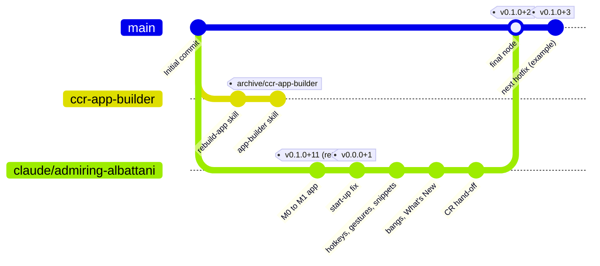

# CR: MouseComb handoff

> [!tip] New session? Say `>resume`
> The agent reads this file and [[META-RULES]], checks git, tells you where things stand in six lines, and carries on with **Next** below. You never need to re-explain the project.

**MouseComb** is a tray app for **Windows 10/11 and Linux**. Bind any hotkey, CapsLock key or mouse gesture to an action, type your snippets anywhere, run a Pomodoro, glance at a clock in the corner of the screen, and search, calculate or jump to a website from one **OmniBar** (`Alt+Space`). Settings sync through your own free server, or stay offline.

**Now:** prototype **0.1.0+2** · everything below is built · the Windows keyboard and mouse hooks have only been tested in code, so **try them on a real PC first** · [Releases](https://github.com/aydieojewelry/MouseComb/releases) · [[CHANGELOG]] · [[APP_SPEC]]

| What you asked for | State | Where to find it |
|---|---|---|
| Mouse gestures | built, Windows | Settings → Bindings → turn on → hold `CapsLock` and drag |
| Keyboard hotkeys you assign | built | Settings → Bindings → New binding |
| Snippet injection | built | Snippets page; bind one, or find it in the OmniBar → *Type “…”* |
| Pomodoro clock | built | Settings → Pomodoro; OmniBar → type `timer` |
| Clock widget | built | Settings → General → Clock on screen |
| OmniBar search | built | `Alt+Space`: apps, commands, calculator, web, `!yt cats` bangs |

> [!warning] Hotkeys, Hyper-Key and gestures start **off**
> One switch in Settings → Bindings turns them on, only on this PC. **`Ctrl+Alt+Pause`** turns them all off again at any time.

## Help

Say a command to your agent. `>commands` start with a short plan you can approve; `--flags` change how they run.

| Say | What happens |
|---|---|
| `>resume` | Reads this file, [[META-RULES]], the top of [[DEVLOG]] and `## Next`; checks git; reports in 6 lines; continues the top item |
| `>status` | Branch, pull request and CI state, last release, what `## Next` would become |
| `>next` | The three best next steps from the **Next** list, each with the command to start it |
| `>plan <goal>` | Plans only: writes your goal as bullets under `## Next` in the changelog and waits for your go |
| `>build` | Builds what is under `## Next`: build and test loop, a commit per phase, a pull request |
| `>release` | Files the bullets under sub-headings, cuts the numbered section, opens the PR, merges after you approve; the workflow publishes |
| `>hotfix <what>` | Rebuilds `main` as the same `x.y.z` with the build number + 1. No branch |
| `>tidy` | `git fetch --prune`, merges or archives leftovers, deletes merged branches (asks first), refreshes this file |
| `>docs` | Updates this file, [[DEVLOG]], the spec and the README table; runs the docs check |

| Flag | Effect |
|---|---|
| `--dry` | Show what would happen; change nothing |
| `--go` | Plan and proceed without waiting for approval |
| `--scope=<area>` | Limit to one area: `input`, `ui`, `omnibar`, `sync`, `release`, `docs` |
| `--no-release` | Build and commit, but don't cut a version |
| `--verbose` | Show the commands run and the reasoning |

Examples: `>build --scope=input --dry` · `>release --no-release` is a contradiction, so the agent asks · `>hotfix installer won't start` · `>plan converter --go`

> [!tip] Next
> First time here? `>status`, then `>next`.

## Launch

```sh
pnpm install                                                          # once, and after pulling
cd services/pocketbase && go run . serve --http 127.0.0.1:8090       # the backend (keep it running)
pnpm dev                                                              # the real app, live reload
pnpm --filter @mousecomb/desktop dev                                  # only the UI, in a browser, example data
```

Needs Node 22 + pnpm 10, Rust (stable), Go 1.27+ for the backend, and the [Tauri prerequisites](https://tauri.app/start/prerequisites/). WebView2 comes with Windows 10/11.

**On Windows, double-click instead:** `scripts\win\setup.bat`, `dev.bat`, `backend.bat`, `app.bat`, `tunnel.bat`, `check.bat`, `build.bat`, `bindings.bat`, `release-next.bat`, `tidy.bat`, `docs.bat`. What each does: [[scripts/win/README|Windows commands]].

**Local addresses**

| Address | What |
|---|---|
| http://localhost:1420 | UI preview. Pages: `#/general` `#/bindings` `#/snippets` `#/whats-new` `#/omnibar` `#/hud` |
| http://127.0.0.1:8090 | PocketBase API (health: `/api/health`) |
| http://127.0.0.1:8090/_/ | PocketBase admin dashboard |

**Tunnelling** (use your PC's backend from a phone or another PC; the address changes every run and anyone with it can reach that port):

```sh
cloudflared tunnel --url http://127.0.0.1:8090        # prints https://<random>.trycloudflare.com
```

Paste that address in Settings → Account & sync as the server. For the UI preview use port `1420`. Alternatives: `ngrok http 8090`, `tailscale serve 8090`.

**Check before you push** (what CI runs):

```sh
cargo fmt --all
cargo clippy --workspace --all-targets -- -D warnings
MC_TEST_PB_URL=http://127.0.0.1:8090 cargo test --workspace            # needs the backend running
pnpm -r typecheck && pnpm -r test
node --test "scripts/*.test.mjs"
node scripts/docs-check.mjs
pnpm --filter @mousecomb/desktop build
cargo check -p mousecomb-desktop --target x86_64-pc-windows-gnu        # from Linux, when Rust changed
pnpm bindings                                                           # when a Tauri command or event changed
```

**Get the app:** [Releases](https://github.com/aydieojewelry/MouseComb/releases) → `MouseComb_*_x64-setup.exe` (Windows, no admin needed; SmartScreen may warn: *More info → Run anyway*), or the `.AppImage`, `.deb`, `.rpm` on Linux.

> [!tip] Next
> `>status` to see where the branches and CI stand, or `>build --scope=ui` to work on a screen.

## Versioning



One trunk, `main`, always releasable. Work happens on a short-lived branch (`claude/<topic>` or `agent/<topic>`), reaches `main` by pull request after you approve, and the branch is deleted. After the hand-off only `main` is left; the old unrelated `ccr-app-builder` branch is kept as a tag.

**`x.y.z+b`**: pick the size by what you wrote under `## Next`.

| Part | Meaning | Comes from |
|---|---|---|
| **x** | main feature | a **Features** or **Core ideas** bullet |
| **y** | minor change | a **Functionality**, **Hotkeys** or **Changes** bullet |
| **z** | fix | a **Fixes** bullet |
| **b** | build; hotfix | +1 on every release; **a hotfix is the same `x.y.z` with `b`+1** |

While `x` is 0 (a prototype) every size moves one place down: a feature makes `0.1.0`, a change or fix `0.0.1`. `1.0.0` is declared by you, nobody else.

**How a release happens**

1. You write what you want as bullets under `## Next` in [[CHANGELOG]].
2. The agent builds it, then files each bullet under a sub-heading: **Features, Functionality, Hotkeys, Core ideas, Changes, Fixes**.
3. `node scripts/version.mjs release` names the section (`## 0.2.0+3 — date — title`) and leaves an empty `## Next`. `node scripts/version.mjs status` previews it.
4. Pull request → you approve → merge. The push that adds the section starts the **Release** workflow: installers for Windows and Linux, tag `vX.Y.Z+B`, a GitHub Release (a pre-release while `x` is 0), and the update feed.

**Hotfix, no branch:** GitHub → Actions → **Release** → *Run workflow* on `main`, type what it fixes. It rebuilds `main` as the same `x.y.z` with `b`+1 and publishes it with your text as the notes. Leave the box empty to retry a release that failed. Afterwards the agent adds the fix under `## Next` → **Fixes** so [[CHANGELOG]] stays complete.

**Rules:** releases come only from `main` · the owner approves every PR and release · squash-merge is the default (the 0.1.0+2 hand-off used one merge commit so history shows its final node) · commit prefixes (`feat:` `fix:` `docs:` …) are labels for readable history and don't decide the version · installers use `x.y.z`, the app and the changelog show `x.y.z+b`.

> [!tip] Next
> `>release --dry` to preview the next version, or `>hotfix <what>` for a quick rebuild.

## Agent knowledge

TOON blocks, most important first. Agents: this is the part to read. Humans can skip it. Layout rules are in the SOP at the end.

### Now and next

```toon
app: MouseComb
version: 0.1.0+2
stage: "prototype (x=0): GitHub pre-releases for Windows 10/11 and Linux x64"
repo: "https://github.com/aydieojewelry/MouseComb (public)"
built[8]: "hotkey bindings: any hotkey runs any action (FEAT-014)",CapsLock Hyper-Key (FEAT-008),"mouse gestures: CapsLock+drag, optional right-drag (FEAT-006)","snippet typing via SendInput, no clipboard (FEAT-005b)",Pomodoro and its OmniBar timer view (FEAT-002),"clock widget: 4 analog + 4 digital faces, fades near the mouse (FEAT-001)","OmniBar search: apps, commands, snippets, calculator, URLs, web, DuckDuckGo bangs + own bangs (FEAT-004, FEAT-023)","Settings, optional sync, updater, What's New page (FEAT-010, FEAT-020, FEAT-022)"
unverified: "Windows hook engine (WH_KEYBOARD_LL, WH_MOUSE_LL, SendInput) is cross-compiled and logic-tested only; it has never run on real Windows"
hooks: "off by default: switch in Settings > Bindings (local setting input.enabled), panic key Ctrl+Alt+Pause turns everything off"
```

```toon
[7]{n,who,what,say}:
  1,owner,"Install 0.1.0+2 on Windows. Run: 30 min of normal typing with hooks on (no stuck keys), gestures, snippet typing, panic key",report results
  2,owner,"One-time GitHub setup: updater signing key, hosted PocketBase, branch protection (CR/PIPELINE.md, end)",>status
  3,agent,Fix whatever the Windows test finds (hotfix if it blocks install),>hotfix <what>
  4,agent,"Converter in the OmniBar: currency + everyday units, one text box (CR/BACKLOG.md, no trade units)",>plan converter
  5,agent,Screen edges and corners (FEAT-007),>plan edges
  6,agent,Tray toggle for hotkeys/gestures; hotkeys with only_in rules still swallow the key in other apps,>plan input polish
  7,agent,"M2: opt-in usage counts, Insights add-on, staged rollout",>plan m2
```

### Rules

```toon
order: most important first
list[16]: "APP_SPEC.md (CR/APP_SPEC.md) is the single source of truth. Cite FEAT-xxx and DEC-xxx. Update it in the same change as behavior, data, config or status","Never commit to main. Work on claude/<topic> or agent/<topic>, open a PR, the owner approves and decides releases. Agents never approve or merge without the owner","Never skip, disable or delete a failing test. Fix the code or the wrong assumption","Input layer (APP_SPEC section 3): hook callbacks stay trivial (no locks, IO, DB), the resolver reads an in-memory snapshot, nothing is ever left held down, injected events carry tag 0x4D434D42 in dwExtraInfo",Hooks ship off by default behind input.enabled; the panic key must always work. Never re-register global shortcuts on the shortcut handler thread (deadlock),crates/mc-core never calls OS APIs (shared with mobile); OS code lives in mc-win,Extensions never run on the input path and never get raw hooks; every host call checks manifest permissions,"New capabilities are actions first (FEAT-013): then they are bindable, workflow-able and callable by extensions","Tauri commands and events are typed with tauri-specta: run pnpm bindings, never hand-write TS types; JSON fields use the Json newtype","UI: packages/ui only (Ark UI + Zag, tokens in APP_SPEC section 1), no other component or icon library. Data: packages/data (TanStack DB collections, Query), no useEffect fetching. Lists that grow use TanStack Virtual, tables TanStack Table, forms TanStack Form + Zod",Update packages/data/src/testing/mockBackend.ts whenever a command changes (tests and browser preview use it),"Backend access only through mc_sync::Backend; license and sync never gate core features. Schema changes are Go migrations; new item kinds need none","Privacy: telemetry never collects keys, typed text, clipboard, snippets, window titles or file names (DEC-018)","pnpm only installs packages published 14+ days ago (minimumReleaseAge): do not override","No model names or IDs in files, PR titles or PR bodies (commits carry only the harness attribution trailer). Never send the owner's email anywhere","End of a session: DEVLOG entry, bump version in APP_SPEC section 1, refresh the now/next blocks here, run node scripts/docs-check.mjs, commit and push (workers restart: commit early)"
```

### Commands (also in Launch)

```toon
[16]{name,cmd,note}:
  install,pnpm install,"once, and after pulling"
  backend,"cd services/pocketbase && go run . serve --http 127.0.0.1:8090",Go 1.27+; API and admin on 8090
  app,pnpm dev,the real app with live reload
  preview,pnpm --filter @mousecomb/desktop dev,"UI only in a browser with example data, http://localhost:1420"
  tunnel,"cloudflared tunnel --url http://127.0.0.1:8090",prints a public https address for the backend
  fmt,cargo fmt --all,""
  lint,cargo clippy --workspace --all-targets -- -D warnings,""
  rust_tests,"MC_TEST_PB_URL=http://127.0.0.1:8090 cargo test --workspace",needs the backend running
  windows_check,cargo check -p mousecomb-desktop --target x86_64-pc-windows-gnu,from Linux
  js_checks,pnpm -r typecheck && pnpm -r test,""
  script_tests,"node --test \"scripts/*.test.mjs\"","versioning, docs and .bat checks"
  docs,node scripts/docs-check.mjs,add --fmt to tidy the TOON blocks
  bindings,pnpm bindings,after a Tauri command or event changed
  build,pnpm --filter @mousecomb/desktop build,"front end only; installers: pnpm build"
  next_release,node scripts/version.mjs status,last release and what Next would become
  cut_release,node scripts/version.mjs release,turns ## Next into the numbered section; --dry to look
```

### Versioning

```toon
format: x.y.z+b
parts:
  x: "main feature: a Features or Core ideas bullet"
  y: "minor change: a Functionality, Hotkeys or Changes bullet"
  z: "fix: a Fixes bullet"
  b: "build: +1 on every release. A hotfix is the same x.y.z with b+1"
prototype: "while x=0 every size shifts one place down (feature -> y, change -> z, fix -> z). 1.0.0 happens only when the owner says"
flow[5]: owner writes intent as bullets under ## Next in CHANGELOG.md,"agent builds it, then files each bullet under a sub-heading: Features, Functionality, Hotkeys, Core ideas, Changes, Fixes",node scripts/version.mjs release names the section from the biggest sub-heading and leaves a fresh ## Next,"PR to main, owner approves, merge: the push that adds the section starts the Release workflow","workflow builds Windows and Linux installers, tags vX.Y.Z+B on main, publishes the GitHub Release (pre-release while x=0) and refreshes the update feed"
hotfix: "Actions > Release > Run workflow on main with the hotfix text filled in: same x.y.z, b+1, no branch, no CHANGELOG edit. Afterwards add the fix under ## Next > Fixes so history stays whole"
retry: Run workflow on main with hotfix empty retries the newest CHANGELOG version if its build failed
tags:
  last_release: v0.0.0+1 (this handoff ships v0.1.0+2)
  retired: "v0.1.0+11 (first test prototype, ignored by version.mjs)"
  archive: "archive/ccr-app-builder (old unrelated branch, kept as a tag)"
forms: "tags, Releases, About, CHANGELOG use x.y.z+b; Cargo/tauri.conf/package.json/installers use x.y.z; the build number is compiled in as MOUSECOMB_BUILD"
msi_limits: "x and y at most 255, z at most 65535; version.mjs stops past that"
commit_prefixes: "feat, uplift!, patch, fix, docs, chore, test, ci: labels for readable history. They no longer decide the version"
merge: squash is the default; the 0.1.0+2 hand-off used one merge commit so history shows the final node
```

### Repo, paths, features, decisions

```toon
remote: origin = github.com/aydieojewelry/MouseComb
branches: "main only after the hand-off. Work branches are short-lived (claude/<topic>, agent/<topic>)"
secrets_and_vars:
  TAURI_SIGNING_PRIVATE_KEY: "secret, updater signing (owner setup)"
  TAURI_SIGNING_PRIVATE_KEY_PASSWORD: secret
  MOUSECOMB_UPDATER_PUBKEY: "variable, public key written into the app at release time"
  MOUSECOMB_DEFAULT_SERVER: "variable, hosted PocketBase address baked into releases"
environments: "release: owner is a required reviewer"
ci: "ci.yml on PRs and main: Rust, Backend (Go), Frontend, Docs, Installers (Windows), Installers (Linux). release.yml: see versioning. tidy.yml: one-off branch cleanup (run by hand)"
```

```toon
[12]{path,what}:
  apps/desktop/src-tauri/src,"Tauri shell: engine.rs (hotkeys, hooks, bindings), actions.rs, overlays.rs, pomodoro.rs, updates.rs, whatsnew.rs, state.rs, commands.rs"
  apps/desktop/src,"React: pages/ (General, Pomodoro, Bindings, Snippets, Account, WhatsNew, About), omnibar/ (search, bangs, calc), hud/, router.tsx"
  packages/ui,"design tokens, Ark UI components, icons, ShortcutButton, TimerDial, ClockFace"
  packages/data,"TanStack DB collections (bindings, bangs, snippets, settings), queries, mockBackend"
  packages/bindings,generated Rust to TS client (pnpm bindings)
  crates/mc-core,"pure logic: actions catalog, bindings, input engine (gestures, Hyper), Pomodoro, snippets"
  crates/mc-store,"SQLite items, local settings, meta"
  crates/mc-sync,sync client and the Backend trait
  crates/mc-win,"Windows only: hooks.rs, keys.rs (SendInput), foreground.rs, apps, power"
  services/pocketbase,backend (Go) and migrations
  scripts,"version.mjs (releases), docs-check.mjs, win/*.bat (Windows commands)"
  CR,"handoff folder: this file, META-RULES, BACKLOG, APP_SPEC, DEVLOG, PIPELINE"
```

```toon
[14]{id,name,status,note}:
  FEAT-014,"Bindings: hotkey, Hyper, gesture to any action",TESTING,Settings > Bindings; Windows hooks unverified on real Windows
  FEAT-008,CapsLock Hyper-Key,TESTING,Windows only; hold alone 1.5 s toggles real CapsLock
  FEAT-006,Mouse gestures,TESTING,"Windows only; CapsLock+drag default, right-drag opt-in; threshold 18 px"
  FEAT-005b,Snippets and typing them,TESTING,Windows types with SendInput; Linux copies and says press Ctrl+V
  FEAT-002,Pomodoro,TESTING,Windows and Linux
  FEAT-001,Clock widget (HUD),TESTING,Linux minimum window 200x200 is handled
  FEAT-004,OmniBar incl. bangs,TESTING,Alt+Space; Linux global shortcut needs X11
  FEAT-023,"Quick commands: calculator, apps, web search",TESTING,app list and power actions Windows only
  FEAT-013,Action registry,IN_PROGRESS,grows with each feature; full catalog M3
  FEAT-022,"Installer, updates, What's New",IN_PROGRESS,self-update needs the owner's signing key
  FEAT-020,"Store, account and sync",IN_PROGRESS,E2E encryption later
  FEAT-007,Screen edges and corners,PLANNED,BACKLOG
  FEAT-015,Workflows,PLANNED,M4
  FEAT-016,Extensions,PLANNED,M5
```

```toon
[13]{id,what}:
  DEC-001,React 19 + TypeScript UI
  DEC-007,"No window management, ever"
  DEC-008,Tauri v2 shell with plugins
  DEC-010,PocketBase backend behind the Backend trait
  DEC-016,"OmniBar hotkey Alt+Space, changeable"
  DEC-017,"Sign-in optional: Use offline on first launch"
  DEC-018,"Telemetry on by default with a switch; never keys, text, clipboard, titles, file names"
  DEC-019,Public repo; Releases host installers and the update feed
  DEC-022,Owner approves every PR and every release; agents never approve
  DEC-024,Linux is a production target; input engine is Windows-first
  DEC-025,"Hooks (hotkeys, Hyper-Key, gestures) ship off by default, one switch, one panic key"
  DEC-026,"CHANGELOG ## Next drives versions; releases only from main; b = hotfix, no branch"
  DEC-027,"CR folder is the hand-off: CR.md first, then META-RULES; Obsidian-friendly"
```

### Gotchas

```toon
[12]: "Create Tauri windows only after app.manage(AppState) (tauri.conf windows create:false), or WebView2 calls commands before the state exists and the page shows 'Something went wrong'","tauri-plugin-global-shortcut holds its mutex while a shortcut handler runs: register/unregister shortcuts from another task (panic key spawns async), never on the handler thread","Linux windows are never smaller than 200x200: lay the HUD out in that box at the top-left","Tag pushes from agent sessions fail through the proxy: release by pushing a CHANGELOG section to main, not by git push tag","RegisterHotKey swallows the key everywhere, so a hotkey with only_in still takes the key in other apps (known limit)","Hyper-Key and gestures need the low-level hooks: Windows only; Linux gets hotkeys on X11 only","TanStack DB: write through the collection, wait for isPersisted; items-changed reloads rows; keep the key equal to the item key","specta-typescript 0.0.12 loops on serde_json::Value: use the Json newtype or specta_typescript::Unknown","Never disable a form's submit button for an incomplete form: let the click show what is missing","Ark UI radios and switches hide their inputs: in tests click the label or [data-scope=switch][data-part=control]","pkill -f can kill your own shell: use pkill -x mousecomb-deskt or kill by pid","Workers restart without warning: commit and push after every phase"
```

### Agents, documents, resume, loop

```toon
[4]{who,reads,note}:
  Claude Code,CLAUDE.md then CR/CR.md,steward skill in .claude/skills/steward drives branch to merged to released
  "Antigravity, Codex, Cursor, others",AGENTS.md then CR/CR.md,same rules; >commands work the same way
  Claude design canvas,design tokens in APP_SPEC section 1,"mock a screen as an artifact, get the owner's comments, then build it; one artifact per purpose"
  owner,"this file, top part only","writes ## Next, approves PRs and releases, runs the Windows tests"
```

```toon
[8]{n,file,role,when}:
  1,CR/CR.md,"state, commands, rules: read first",every session
  2,CR/META-RULES.md,"how we work: rules, style, workflows, lessons","every session, skim"
  3,CHANGELOG.md,"## Next is the owner's intent; sections are releases",every session
  4,CR/DEVLOG.md,"what each session did, newest first",top entry
  5,CR/APP_SPEC.md,"features, architecture, data, decisions (FEAT, DEC ids)",the section you touch
  6,CR/PIPELINE.md,"branch to users: CI, review, release, owner setup",shipping
  7,CR/BACKLOG.md,"ideas not yet planned, with design notes",planning
  8,scripts/win/README.md,the Windows .bat commands,owner on Windows
```

```toon
[4]: "read CR/CR.md (this), CR/META-RULES.md, the top of CR/DEVLOG.md and ## Next in CHANGELOG.md; read nothing else unless the task needs it","git fetch --prune; note branch, open PRs and CI state; if the PR for the work branch merged, restart the branch from main","reply in at most 6 lines: version, what changed since the last DEVLOG entry, what is blocked on the owner, the top next item",then continue the top next item; plan first unless it is a --go or a small fix
```

```toon
owner_touches[4]: "## Next in CHANGELOG.md",approving PRs and releases,one-time setup in CR/PIPELINE.md,testing on real Windows
agent_touches: "everything else: code, tests, specs, docs, PRs, release cut, CR refresh"
never_lose_the_loop: "every session ends with a DEVLOG entry, a refreshed now/next block here and a pushed branch, so the next session (any agent) resumes from the repo alone"
```

## How to write CR (SOP)

Follow this every time you create or refresh this file.

1. **Order.** Human summary and callout first (skimmable in 20 seconds), then **Help**, **Launch**, **Versioning**, then the TOON blocks. Inside the blocks: now and next, rules, commands, versioning, repo and features, gotchas, the rest. Most important first, least important last.
2. **One home per fact.** Commands, rules and status live in the TOON blocks. Prose shows the same commands for people, and `docs-check` fails if a TOON command is missing from **Launch**. Long explanations belong in [[APP_SPEC]], [[PIPELINE]] or [[META-RULES]]; link, don't copy.
3. **Spend tokens carefully.** Keep this file under about 350 lines. Delete what git, [[DEVLOG]] or the spec already say: past sessions, finished tasks, history. Facts only: no hedging, no story.
4. **Write TOON like this.** `key: value` objects; `items[N]{a,b}:` tables for rows of the same shape; `items[N]:` with `- ` lines for plain lists; two-space indent; quote any value with a colon or comma. Don't hand-format: edit, then run `node scripts/docs-check.mjs --fmt`.
5. **Human parts.** Plain words, short sentences, tables for choices, one callout per section for the next step. Obsidian: front matter on top, `[[wikilinks]]` between notes, `> [!tip]` and `> [!warning]` callouts, no HTML.
6. **Refresh when.** End of every session (version, `now`, `next`, `updated`), when a command, URL, rule or decision changes, after every release or branch cleanup (`>tidy`).
7. **Then verify.** `node scripts/docs-check.mjs` must pass: links and wikilinks resolve, TOON parses, commands match, every `.md` is in the README table. CI runs it too.
8. **Smoke test.** From a fresh clone, say `>resume` to an agent that knows nothing; it must reach the right next step by reading only this file, [[META-RULES]], [[DEVLOG]] and `## Next`. If it can't, the file is missing something: fix the file, not the agent.

> [!tip] Next
> `>docs` refreshes this file and runs the check.
