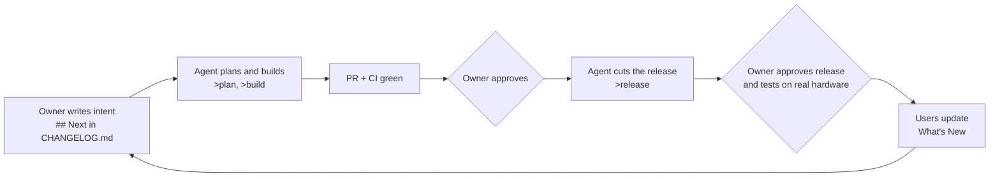

# META-RULES: how we work on MouseComb

> [!info] What this is
> The playbook behind the project: the owner's preferences, the rules, the workflows, the lessons learned and the reply style. [[CR]] says **where things stand**; this says **how to work**. Read it at the start of a session, skim the parts you know. Works the same for Claude Code, Antigravity or any other agent.

> [!tip] Using this as an Obsidian vault
> Open the **repo folder** in Obsidian (*Open folder as vault*). The committed `.obsidian/app.json` makes `[[links]]` use the shortest path and hides build folders. Start at [[CR]]; graph view shows how the notes link. Don't commit `workspace.json` or other personal Obsidian files. Tags used below: #rule #design #workflow #lesson #idea #style.

**Contents:** [[#1. The owner]] · [[#2. Rules]] · [[#3. Design intents]] · [[#4. Useful ideas]] · [[#5. Workflows]] · [[#6. Lessons learned]] · [[#7. Reply style]] · [[#8. The human-in-the-loop system]] · [[#9. App shell first, then autonomous]] · [[#10. Windows commands (.bat)]] · [[#11. Tool notes]]

## 1. The owner
#memory
- Owns the repo `aydieojewelry/MouseComb` (public). Decides **what** and **when**; the agent decides **how**.
- Builds on a Windows PC and ships for **Windows and Linux**. Tests the real installer, then approves.
- Wants to **stay in the loop without being asked a lot**: only decisions that are really theirs, with a recommended default.
- Uses Claude (Claude Code, the design canvas) and Antigravity. Any new session must be able to continue from the **repo alone**: read [[CR]], say `>resume`.
- Likes a visual check before code: a design mock on the canvas, comments on it, then "start implementing".
- Likes things **free or cheap** (free-tier hosting for PocketBase), **offline-capable**, and **early prototypes that scale**.
- Wants **one artifact per purpose**, no duplicates, and docs that are skimmable on top with the detail below.
- Telemetry is on by default with a clear switch and never collects keys, typed text, clipboard, snippets, window titles or file names (DEC-018).
- An earlier project of theirs, *Tauri Calc*, inspired the converter idea ([[BACKLOG]]). **Trade-specific units are out of scope**; only currency and everyday units.
- Private details (email, accounts) never go into the repo or any outside service.

## 2. Rules
#rule
1. The spec ([[APP_SPEC]]) is the single source of truth. Cite `FEAT-xxx` / `DEC-xxx`. Behavior, data, config or status changes update it **in the same change**.
2. **Never commit to `main`.** Branch `claude/<topic>` or `agent/<topic>`, pull request, the owner approves, the owner decides releases. Agents never approve or merge on their own.
3. **A failing test is information.** Fix the code or the wrong assumption; never skip, disable or delete the test.
4. **Safe by default.** Hotkeys, Hyper-Key and gestures ship **off** behind one switch (`input.enabled`) and a panic key (`Ctrl+Alt+Pause`). Destructive actions ask for a second confirmation.
5. **Input path stays trivial:** hook callbacks do no locking, IO or DB; the resolver reads an in-memory snapshot; nothing is ever left held down; every injected event is tagged (`0x4D434D42`).
6. **Pure core:** `mc-core` has no OS calls so it can run on mobile; OS code lives in `mc-win` and later per-platform crates.
7. **Actions first:** a new capability becomes an action (FEAT-013), so it is bindable, usable in workflows and callable by extensions.
8. **Typed boundaries:** Tauri commands and events through `tauri-specta`; run `pnpm bindings`; never hand-write TS types.
9. **UI:** only `packages/ui` (Ark UI + Zag, the tokens in the spec); data only through `packages/data`; no `useEffect` data fetching; Virtual for long lists, Table for tables, Form + Zod for forms.
10. **Backend through `mc_sync::Backend`** only; sync and licensing never block core features; schema changes are Go migrations.
11. **Update `mockBackend.ts`** whenever a command changes, so tests and the browser preview keep working.
12. `pnpm` installs only packages older than 14 days (`minimumReleaseAge`). Don't override it.
13. **No model names or IDs** in files, PR titles or PR bodies. Never send the owner's email anywhere.
14. **Versions come from the changelog**, releases only from `main` ([[CR#Versioning]]).
15. **End every session** with a [[DEVLOG]] entry, the `version` bump in the spec, a refreshed `now`/`next` in [[CR]], `node scripts/docs-check.mjs`, a commit and a push.

## 3. Design intents
#design
- **Native feel:** Windows 11 look (Fluent line icons, Mica-style surfaces), dark first, keyboard-complete, accessible (Ark UI / Zag).
- **One purpose per screen.** Settings save as you change them; no "Apply" step. Cards, not walls of options.
- **Everything is an action.** Triggers (hotkey, CapsLock key, gesture, later edge, chord, schedule) → bindings → actions. The OmniBar is the hub that lists them all.
- **Safe, then fast.** Off by default, confirm the dangerous, undo what you can; then make the common path one keystroke.
- **Honest UI.** Say what is unverified or unavailable ("Windows only", "needs X11") instead of hiding a control.
- **Offline first.** Everything saves locally; sync is optional and never gates a feature.
- **Small and quiet.** Tray app, tiny installer, idle cost near zero (no polling loops, no always-on timers beyond the clock).
- **Same code everywhere.** Pure Rust core + React UI shared by Windows, Linux and (later) mobile.
- **Extensions later, on the public API only.** Bundled extensions use only `@mousecomb/api`.

## 4. Useful ideas
#idea  (not committed to; promote to `## Next` with `>plan`)
- Tray toggle for hotkeys/gestures; a cheat-sheet generated from live bindings (FEAT-009).
- Hotkeys with `only_in` that pass the key through in other apps (needs the hook path, not `RegisterHotKey`).
- Import DuckDuckGo's full bang list as an optional download; `Caps+Space` as a second OmniBar opener.
- Snippet expansion from typed trigger text; clipboard history (FEAT-005a); weather widget (FEAT-003).
- A converter in the OmniBar (currency + everyday units) and screen edges/corners: details in [[BACKLOG]].
- Export/import of bindings; per-app gesture sets; a gesture trail overlay.
- Weekly usage report from opt-in telemetry feeding `## Next` (M2).

## 5. Workflows
#workflow

### Session loop
1. `>resume` (read [[CR]], this file, top of [[DEVLOG]], `## Next`; `git fetch --prune`).
2. Plan in ≤ 8 lines if the work is more than a small fix; wait for "go" unless `--go`.
3. Build in **phases**; after each phase: checks, commit, push (workers restart without warning).
4. Verify for real: run the app or the preview and look; don't call UI done from tests alone.
5. Hand off: [[DEVLOG]], `build` bump, refresh [[CR]] (`now`, `next`, `updated`), `node scripts/docs-check.mjs`, push.

### Steward loop (branch → merged → released)
Procedure: `.claude/skills/steward/SKILL.md`. In short: branch from `main` → build-test loop (fmt, clippy, tests with the live backend, typecheck, bindings, desktop build, Windows cross-check) → PR with a prefixed title → CI green → owner approves → merge → release via the workflow. Details: [[PIPELINE]].

### Design-canvas loop
Mock the screen as an artifact on the design canvas → the owner comments → refine → "start implementing" → build from the tokens in the spec → compare with the mock in the browser preview → screenshot → ask for the next comment. One artifact per purpose; reply to a comment in one line.

### Release and hotfix
Release: intent in `## Next` → build → `node scripts/version.mjs release` → PR → approve → merge → workflow publishes. Hotfix: Actions → Release → *Run workflow* on `main` with the fix text; same `x.y.z`, `b`+1, no branch. Full steps: [[CR#Versioning]].

### Verification toolbox
- Rust: `cargo fmt`, `cargo clippy -D warnings`, `cargo test --workspace` with `MC_TEST_PB_URL` (live PocketBase), cross-check `--target x86_64-pc-windows-gnu`.
- Front end: `pnpm -r typecheck`, `pnpm -r test`, preview at http://localhost:1420 driven by Playwright (use the global install; click label text for radios and `[data-scope=switch][data-part=control]` for switches).
- Real app on Linux: Xvfb + `xdotool` for keys and clicks + ImageMagick `import` for screenshots; seed a fresh SQLite profile to test settings.
- Workflows: `actionlint`. Docs: `node scripts/docs-check.mjs`.

## 6. Lessons learned
#lesson
- **Windows opened before the state existed.** Windows created from `tauri.conf.json` can load before `setup` runs and call commands that need `AppState`: show "Something went wrong". Fix: `"create": false`, build windows right after `app.manage(...)`.
- **Shortcut handler deadlock.** `tauri-plugin-global-shortcut` holds its mutex while a handler runs; unregistering from inside it freezes the app. Register and unregister from another task (the panic key spawns async).
- **Linux windows are at least 200×200.** Draw the HUD inside that box at the top-left.
- **Tag pushes from agent sessions fail** through the proxy (`send-pack: unexpected disconnect`). Release by pushing a `CHANGELOG.md` section to `main` instead.
- **Workers restart** without warning: commit and push after every phase.
- **`pkill -f` can kill your own shell.** Use `pkill -x <name>` or `kill <pid>`.
- **Disabled submit buttons hide the problem.** Let the click run and show what is missing.
- **`specta-typescript` 0.0.12 loops on `serde_json::Value`.** Use the `Json` newtype or `Unknown`.
- **`RegisterHotKey` swallows the key everywhere**, so `only_in` can't pass it through yet.
- **Rejected plans are information.** When the owner rejects a plan with a note ("leave out X", "I'll upload the files"), apply exactly that and re-plan shorter; don't defend the old plan.
- **"On selected text" comments are precise instructions.** Change that text and nothing else.
- **Re-planning around the owner's tests beats guessing:** the 0.0.0+1 fix came from a screenshot of a real Windows error, not from a theory.

## 7. Reply style
#style
- **Short.** Lead with the outcome, then only what the owner must decide or know. No recap of the request, no tool narration.
- **Decisions as options:** 2–4 labelled choices, the recommended one first, each with one line of consequence.
- **Exact:** versions, paths, commands, numbers. Link PRs and artifacts with full links.
- **Say what is unverified** ("hooks not yet run on Windows") and what the owner should do about it.
- **Tables and short lists** for anything with 3+ parts; plain sentences otherwise. No emojis unless asked.
- **Artifact comments:** one line back, then the change.
- **End with the next command** the owner can say (`>release`, `>plan …`).

## 8. The human-in-the-loop system
#workflow #design
The owner never leaves the loop, and never has to do the agent's work. Three gates need a human; everything else is the agent.

| File | Written by | Read by | Purpose |
|---|---|---|---|
| `CHANGELOG.md` → `## Next` | owner | agent | what to build next (intent in) |
| `CHANGELOG.md` → numbered sections | agent | owner, the app's What's New page | what shipped, under Features / Functionality / Hotkeys / Core ideas / Changes / Fixes |
| [[CR]] | agent | any agent; owner reads the top | where things stand, commands, rules (TOON for agents) |
| [[META-RULES]] | both | agent | how to work (this file) |
| [[APP_SPEC]] | agent | agent | what and why: features, architecture, decisions |
| [[DEVLOG]] | agent | agent | what each session did |
| [[PIPELINE]] | agent | owner, agent | branch → users; the owner's one-time setup |
| [[BACKLOG]] | both | both | ideas not yet planned |

Gates: **(1)** the owner's intent, **(2)** the owner approves the PR, **(3)** the owner approves the release and tries it on a real PC. Commands: `>resume` `>status` `>next` `>plan` `>build` `>release` `>hotfix` `>tidy` `>docs` with flags `--dry` `--go` `--scope=` `--no-release` `--verbose` ([[CR#Help]]).

## 9. App shell first, then autonomous
#workflow
How to start **any** new app so the owner is in the loop from day one:

1. **Intake** (one message): the goal in a paragraph, plus three decisions: name, platforms, where it is hosted. Pick defaults for everything else and record them as `DEC-xxx`.
2. **Repo skeleton:** `README.md`, `CLAUDE.md` and `AGENTS.md` (a few lines pointing to `CR/CR.md`), `CR/` with `CR.md`, `META-RULES.md`, `BACKLOG.md`, `APP_SPEC.md`, `DEVLOG.md`, `PIPELINE.md`; `CHANGELOG.md` with an empty `## Next`; `.gitattributes`; `.obsidian/app.json`; `scripts/version.mjs` and `scripts/docs-check.mjs` with their tests.
3. **Pipeline before features:** CI (build, test, installers for every target), the changelog-driven release workflow, PR template, `CODEOWNERS`, the steward skill, and the owner's one-time setup list (branch protection, signing key).
4. **The shell:** the smallest installable app: a window and tray, one settings page, single instance, local store, typed commands, one action and a palette to run it. CI builds installers on every target. Release it as `0.0.0+1`.
5. **The owner installs the shell** and says it works. Now the whole path (build → release → install → update) is proven while the code is small.
6. **Autonomous feature loop:** owner writes `## Next` → `>plan` → `>build` → PR → approve → `>release`. Each feature: **action first, UI second**, safe default, tests, spec + changelog in the same PR.
7. **Every session ends with the hand-off** (DEVLOG, CR refresh, docs check, push), so the next session starts with `>resume`.

> [!tip] Why shell first
> Packaging, signing, updating and releasing are where projects stall. Doing them first, with almost no code, means every later feature ships through a path that already works.

## 10. Windows commands (.bat)
#workflow
Frequently used commands are `.bat` files in **`scripts\win\`**: double-click, or type the name in `cmd`/PowerShell. They find the repo themselves and say what tool is missing. Full table: [[scripts/win/README|Windows commands]]; the same commands for other shells are in [[CR#Launch]].

| File | Use |
|---|---|
| `setup.bat` | install everything (once, and after pulling) |
| `dev.bat` · `app.bat` · `backend.bat` | UI preview · the real app · the backend |
| `tunnel.bat [port]` | public address for the backend through Cloudflare |
| `check.bat` | everything CI checks, before you push |
| `build.bat` | installers on this PC |
| `bindings.bat` | after changing a Tauri command |
| `release-next.bat` | preview the next version |
| `tidy.bat` | refresh git and list leftovers |
| `docs.bat [--fmt]` | check the docs |

**To add one:** a command the owner runs more than twice, or that has more than one step. One job, a `rem` line on top, `cd /d "%~dp0..\.."`, tool check with `call "%~dp0_need.bat" <tools> || exit /b 1`, stop on the first failure. No drive letters or user names in paths. No `< > | & %` in `rem`/`echo` text unless escaped with `^`. CRLF line endings are kept by `.gitattributes`. Add it to the README table; `docs.bat` fails if you forget. Agents can't run `.bat` files on Linux: test the same steps with the shell commands in [[CR#Launch]] and say so.

## 11. Tool notes
- **Claude Code (web or desktop):** reads `CLAUDE.md`. Pull requests and releases go through the GitHub tools, not the `gh` CLI. The harness asks commits to end with its attribution trailer; add nothing else about the model. Skill: `steward`.
- **Antigravity and others:** read `AGENTS.md`, then [[CR]]. The `>commands` and `--flags` mean the same; there are no skills, so follow the steward steps in `.claude/skills/steward/SKILL.md` by hand.
- **Design canvas:** Claude artifacts. Keep one per purpose and reply to comments in one line.
- **Chromium and Playwright** are preinstalled in the cloud container; don't run `playwright install`.
