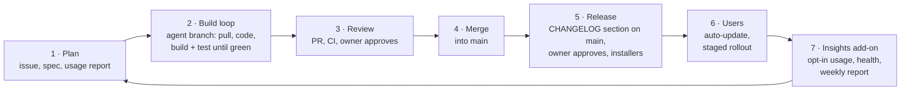

# MouseComb delivery pipeline

How a change goes from an idea to every user's PC. Written for people and AI agents (Claude Code, Antigravity, others). Agents follow the step-by-step version in [`.claude/skills/steward/SKILL.md`](../.claude/skills/steward/SKILL.md).

| Step | Who | Where | Human gate |
|---|---|---|---|
| 1 Plan | Owner, agents | GitHub issues, `APP_SPEC.md`, `reports/usage/` | Owner picks what's next |
| 2 Build loop | AI agent | Its own branch (`claude/…`, `agent/…`) | — |
| 3 Review | CI + owner | Pull request | **Owner approves the PR** |
| 4 Merge | Owner or agent after approval | `main` | Only after approval and green CI |
| 5 Release | `scripts/version.mjs release` + Release workflow | GitHub Release | **Owner approves the `release` environment** |
| 6 Users | Updater in the app | Every install | Rollout pauses itself if health drops (M2) |
| 7 Insights | Insights add-on | Backend + repo report | — |

## 1 · Plan
- Work starts from an issue or an `APP_SPEC.md` milestone item, cited by ID (`FEAT-xxx`).
- From M2 on, the weekly usage report (`reports/usage/YYYY-Www.md`) is an input: what people use, what crashes, what nobody finds.

## 2 · Build loop (agent)
1. Pull: `git fetch origin && git checkout -B <branch> origin/main`.
2. Make the change. Keep it to one purpose.
3. Run the checks until all pass (the same ones CI runs):
   - backend running: `cd services/pocketbase && go run . serve --http 127.0.0.1:8090`
   - `cargo fmt --all && cargo clippy --workspace --all-targets -- -D warnings`
   - `MC_TEST_PB_URL=http://127.0.0.1:8090 cargo test --workspace`
   - `pnpm -r typecheck && pnpm -r test && node --test "scripts/*.test.mjs"`
   - `pnpm --filter @mousecomb/desktop build`
   - after changing a Tauri command: `pnpm bindings`
   - Windows check from Linux: `cargo check -p mousecomb-desktop --target x86_64-pc-windows-gnu`
4. For UI changes, look at the result: browser preview (`pnpm --filter @mousecomb/desktop dev`) or the real app.
   - `node scripts/docs-check.mjs` (links, wikilinks, TOON blocks, README table)
5. Commit with a label (`uplift!:`, `feat:`, `patch:`, `fix:`, `docs:`, `chore:`, `test:`, `ci:`) and push. User-facing changes also go under `## Next` in `CHANGELOG.md`.

## 3 · Review
- Open a pull request into `main`. The title starts with a label (`feat:`, `fix:`, …); labels keep history readable, the version comes from the changelog (`CR/CR.md`, Versioning).
- CI ([`.github/workflows/ci.yml`](../.github/workflows/ci.yml)) runs these jobs: Rust (format, lint, tests against a live backend, bindings check), Backend (Go), Frontend (types, tests, build), and Installers for Windows and Linux (unsigned test installers you can download from the run).
- Red CI: the agent fixes and pushes again. It never skips or disables a test.
- The owner (see [`.github/CODEOWNERS`](../.github/CODEOWNERS)) reviews and approves.

## 4 · Merge
- Squash merge by default, after approval and green CI; a merge commit when history should show a hand-off node (done once, for 0.1.0+2). Delete the branch.
- `main` must always be releasable.

## 5 · Release
Versions are `x.y.z+b` and come from `CHANGELOG.md` (full rules and a git graph: [`CR.md`](CR.md#versioning)). Releases are always built from `main`.

1. The owner writes intent under `## Next`; the agent builds it and files each bullet under Features, Functionality, Hotkeys, Core ideas, Changes or Fixes.
2. `node scripts/version.mjs release` (in the PR that ships the change) turns `## Next` into `## x.y.z+b — date — title`, picking the size from the biggest sub-heading, and leaves an empty `## Next`.
3. The merge to `main` adds that section, which starts [`release.yml`](../.github/workflows/release.yml):
   - **waits for the owner to approve** the `release` environment;
   - creates a draft release, builds the Windows installers (NSIS, MSI) on a Windows runner and the Linux packages (AppImage, .deb, .rpm) on Ubuntu 22.04 in parallel, signs the update files when the key is set up, tags `vX.Y.Z+B` and publishes (a pre-release while `x` is 0) with the changelog section as notes;
   - copies `latest.json` to the fixed release tag **`updates`**, which installed apps read (see 6).
4. **Hotfix (no branch):** Actions → Release → *Run workflow* on `main`, type what it fixes. Same `x.y.z`, `b`+1, your text as the notes. Leave it empty to retry a failed release.
5. Pushing a tag `vX.Y.Z+B` releases exactly that version too (this works from the owner's machine; agent sessions can't push tags).

## 6 · Users
- The app checks for updates at start and every 24 h, downloads in the background, installs on restart (FEAT-022). It reads `https://github.com/aydieojewelry/MouseComb/releases/download/updates/latest.json`: GitHub's "latest" skips pre-releases and every `0.y.z` is one, so the workflow refreshes that fixed file on each release.
- After an update the app opens the **What's new** page once (it reads `CHANGELOG.md`); not on a new install, and not when started hidden at login.
- **Staged rollout (M2):** the update check goes to the backend instead of a static file. A new version reaches 10 % of installs first, then 50 %, then everyone, and stops if the Insights add-on reports worse health than the previous version.

## 7 · Insights add-on (M2, subproject `services/insights`)
A separate, optional subproject. The app works fully without it.

| Part | What it does |
|---|---|
| Ingest | Reads the opt-in `telemetry` events from the backend once a day |
| Health | Crash-free sessions and error rates per version; compares a new version with the previous one |
| Trends | Feature adoption over time (OmniBar, Pomodoro, quick commands, sync) |
| Basic ML | Anomaly detection on daily rates (rolling baseline, alert on big deviations); grouping installs by usage pattern (k-means on feature counts) to see what kinds of users exist |
| Outputs | `reports/usage/YYYY-Www.md` (aggregates only) via a PR; a release health signal for staged rollout; issues for anomalies |

Privacy rules (FEAT-024, DEC-018) apply to everything here: opt-in only, counts only, no typed text, clipboard, snippets, window titles or file names, no per-user rows in reports.

## One-time setup on GitHub (owner)
1. **Branch protection on `main`:** require a pull request, 1 approval from code owners, and these checks to pass: `Rust (lint + tests with live backend)`, `Backend (Go)`, `Frontend (types, tests, build)`, `Installers (Windows)`, `Installers (Linux)`. Block force pushes. Allow squash merges and merge commits.
2. **Environment `release`:** add yourself as a required reviewer.
3. **Updater signing key** (once, keep it safe; losing it means installed apps can't update):
   - run `pnpm --filter @mousecomb/desktop tauri signer generate -w ~/.tauri/mousecomb.key`;
   - save the private key file's contents and its password as **secrets** `TAURI_SIGNING_PRIVATE_KEY` and `TAURI_SIGNING_PRIVATE_KEY_PASSWORD`;
   - save the public key (`~/.tauri/mousecomb.key.pub`) as the **variable** `MOUSECOMB_UPDATER_PUBKEY`. The release workflow writes it into the app; without it, releases still ship but cannot update themselves (a warning says so).
4. **Backend:** host `services/pocketbase` (free VM, see its README), set up SMTP in its dashboard so password-reset emails go out, and save its address as the **variable** `MOUSECOMB_DEFAULT_SERVER`.
5. Release downloads are public because this repo is public (DEC-019). If it ever goes private, publish releases to a public `mousecomb-releases` repo instead and change the updater address in `tauri.conf.json`.
