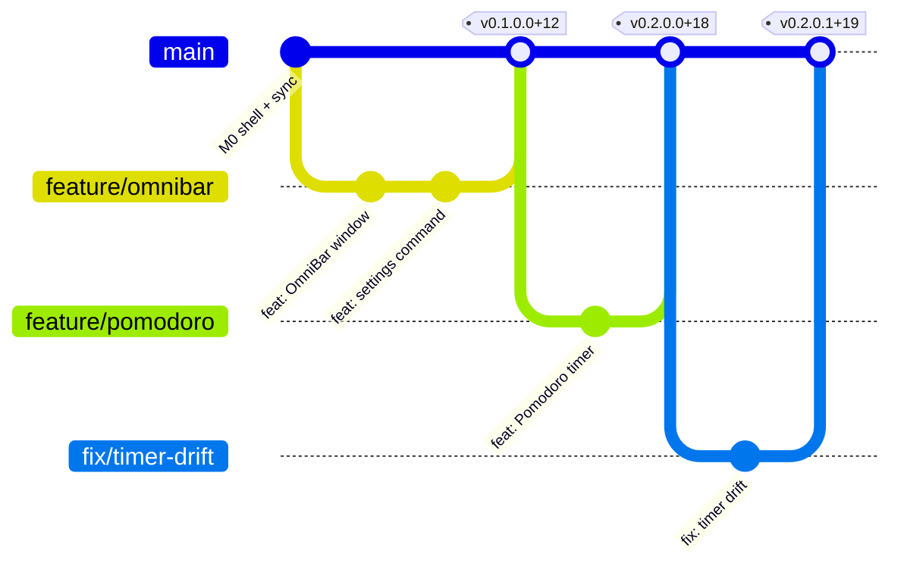
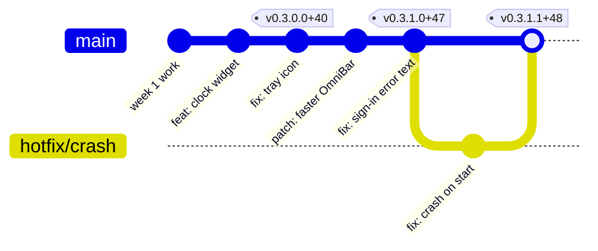

# MouseComb versioning

Every release is named **`w.x.y.z+b`**:

| Part | Name | Bump when | Resets |
|---|---|---|---|
| **w** | Major schematic uplift | Data format, sync protocol or extension API changes in a way that needs a migration | x, y, z → 0 |
| **x** | Feature update | A new user-visible feature ships | y, z → 0 |
| **y** | Patch | An existing feature changes or improves, with nothing new added | z → 0 |
| **z** | Fix | Only bug fixes | — |
| **b** | Build number | Every CI build, success or not | never resets |

Examples: `0.1.0.0+12` (first installable build), `0.2.0.0+31` (the OmniBar gains a feature), `0.2.1.0+35` (Pomodoro tweak), `0.2.1.1+36` (a crash fix), `1.0.0.0+120` (production 1.0).

`w` stays `0` until production 1.0 (milestone M9). The build number `b` lets two builds of the same version be told apart, and doesn't decide which version is newer.

## How the next version is chosen

The release script reads the commit messages since the last tag and takes the biggest bump it finds:

| Commit prefix | Bumps |
|---|---|
| `uplift!:` or a `BREAKING:` footer | w |
| `feat:` | x |
| `patch:`, `perf:` | y |
| `fix:` | z |
| `docs:`, `chore:`, `test:`, `ci:` | nothing (no release on their own) |

`b` is the CI run number.

## Where each form is used

Windows installers and the Tauri updater only accept three-part versions, so one release has two spellings plus a build number:

| Where | Form | Example for `0.2.1.3+36` |
|---|---|---|
| Git tag, GitHub Release, About page, docs | `w.x.y.z+b` | `v0.2.1.3+36` |
| `Cargo.toml`, `tauri.conf.json`, `package.json`, updater (SemVer), MSI installer (`major.minor.build`, build ≤ 65535) | `w.x.(y·100+z)` | `0.2.103` |
| Build number inside the app | `MOUSECOMB_BUILD` at compile time | `36` |

Limits that keep this exact: `z` ≤ 99 and `y` ≤ 654. The release script stops if either is exceeded.

## Branches and releases

Trunk-based: `main` is always releasable. Work happens on short-lived branches (agent sessions use `claude/…`), merged by pull request. A release is a tag on `main`.

### Weekly release train

- **Every week**, the release workflow tags whatever is on `main` (if anything user-facing changed), builds the signed installer and update files, and publishes a GitHub Release.
- **Hotfixes** don't wait for the week: a `fix:` merged to `main` can be released the same day.
- The installed app checks for updates at start and every 24 hours, downloads in the background, and installs on the next restart.

## Until the first release
Before the first installable build (end of M1), work sessions are logged in `DEVLOG.md` as `B-0001`, `B-0002`, … From the first release on, every `DEVLOG.md` entry names the version it shipped in, and `CHANGELOG.md` lists user-facing changes per release.
