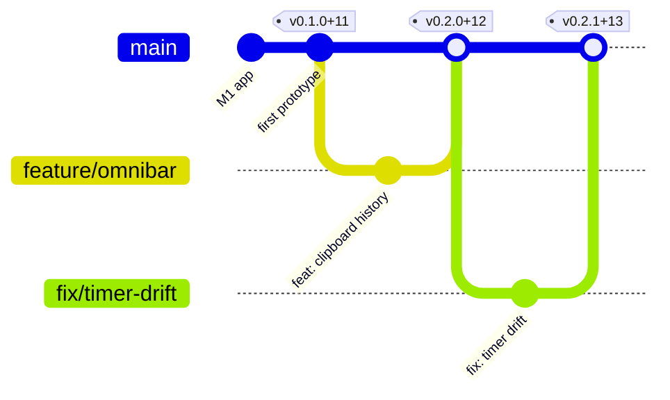

# MouseComb versioning

Every release is named **`x.y.z+b`**:

| Part | Name | Bump when | Resets |
|---|---|---|---|
| **x** | Main feature | A new user-visible feature ships, or something changes in a way that needs a migration (data format, sync protocol, extension API) | y, z → 0 |
| **y** | Minor change | An existing feature changes or improves, with nothing new added | z → 0 |
| **z** | Fix / patch | Only bug fixes | — |
| **b** | Build | Every release, including a hotfix rebuild of the same `x.y.z` | never resets |

Examples: `0.1.0+11` (first prototype), `0.2.0+12` (a new feature), `0.2.1+13` (a Pomodoro tweak), `0.2.1+14` (the same code rebuilt as a hotfix, e.g. a broken installer), `0.2.2+15` (a crash fix), `1.0.0+40` (production 1.0).

- **`0.y.z` is a prototype:** published as a GitHub pre-release. `1.0.0` is production (milestone M9).
- **The build number `b` always grows by one per release**, so any two releases can be told apart by it alone. It continues the `B-000N` counter of `DEVLOG.md` (B-0010 was the last dev build; the first release is build 11).

## How the next version is chosen

The release script (`scripts/version.mjs next`) reads the commit messages since the last tag and takes the biggest bump it finds:

| Commit prefix | Bumps |
|---|---|
| `feat:`, `uplift!:` or a `BREAKING:` footer | x |
| `patch:`, `perf:` | y |
| `fix:` | z |
| `docs:`, `chore:`, `test:`, `ci:` | nothing (no release on their own) |

## Where each form is used

| Where | Form | Example |
|---|---|---|
| Git tag, GitHub Release, About page, `CHANGELOG.md` | `x.y.z+b` | `v0.2.1+13` |
| `Cargo.toml`, `tauri.conf.json`, `package.json`, updater, MSI installer | `x.y.z` | `0.2.1` |
| Build number inside the app | `MOUSECOMB_BUILD` at compile time | `13` |

MSI installers need `x` and `y` ≤ 255 and `z` ≤ 65535; the release script stops past that.

## How to release

- **A chosen version (owner):** add a section `## X.Y.Z+B — date — title` at the top of `CHANGELOG.md` and push. The Release workflow sees a version with no tag yet, builds the Windows and Linux installers, tags the pushed commit `vX.Y.Z+B` and publishes the GitHub Release with that section as its notes. Prototypes (`0.y.z`) can go out from any branch; `1.0.0` and later only from `main`. Pushing a tag `vX.Y.Z+B` does the same.
- **The weekly train:** once `RELEASES_ENABLED` is `true`, the Release workflow runs every Tuesday (or by hand), picks the next version from the commits, tags `main` and publishes it.

## Branches and releases

Trunk-based: `main` is always releasable. Work happens on short-lived branches (agent sessions use `claude/…`), merged by pull request. A release is a tag.

- **Hotfixes** don't wait for the week: a `fix:` merged to `main` can be released the same day; rebuilding the same code only bumps `b`.
- An installed app with updates on checks at start and every 24 hours, downloads in the background, and installs on the next restart.
- Every `DEVLOG.md` entry names the version it shipped in, and `CHANGELOG.md` lists user-facing changes per release.
